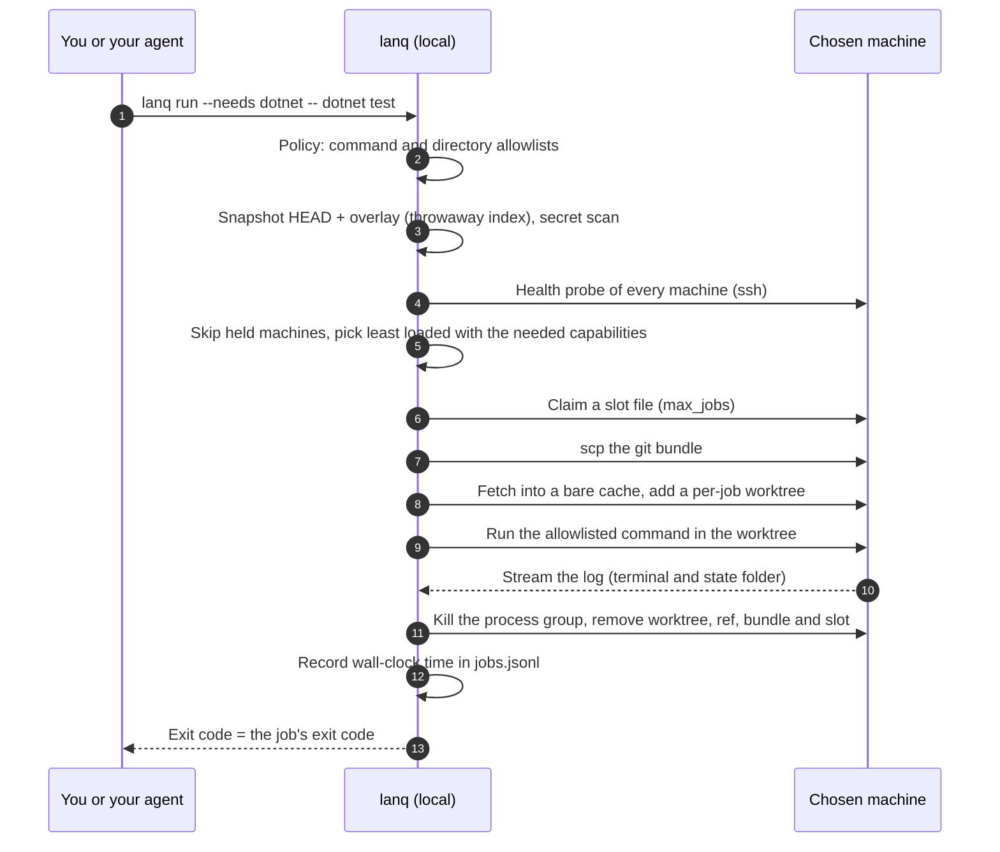

<p align="center"></p>

# LanQueue

**RAM and new hardware are expensive. Your old PCs are not. Plug them back in and give them work.**

`lanq` is a small .NET global tool that sends builds, tests, log analysis and headless coding-agent jobs to the other
computers you already own: the old desktop in the closet, the spare laptop, the small-form-factor box. Your old
machines can still help you get development done. All a worker needs is a LAN connection, SSH, git (or just `tar`, see
[Transfer modes](#transfer-modes-git-default-recommended-or-archive)) and the toolchain for your jobs, and it joins
your queue. Your dev PC stays free for writing code. Even a PC too old or locked down to install git can help: SSH,
tar and your toolchain are enough.

```bash
dotnet tool install --global LanQueue      # update later: dotnet tool update --global LanQueue
```

A 3-command taste (after you list your machines once in `machines.yml`, see [Quick start](#quick-start)):

```bash
lanq health                                                        # which machines are awake and free?
lanq run --needs dotnet,linux -- dotnet test -c Release            # run on the least loaded match
lanq stats                                                         # how long did jobs take?
```

For each job it checks which machines are awake and not busy, picks the least loaded one that has what the job
needs, ships your current git state (HEAD plus uncommitted changes) to a throw-away worktree over key-only SSH, runs
one allowlisted command, streams the log back, cleans up, and records how long it took. It is headless and
scriptable, it has no daemon and no server to install on the remote machines (just `ssh`, `git` or `tar`, and a shell), and it
sends nothing anywhere except to the hosts you list. There is no telemetry.

## Why this exists

This is the author's first-hand account, not a benchmark. The author works on two projects (a .NET API and a web
front end) from one dev PC. One overnight run put two heavy agent-driven build/test jobs, the local dev stack and a
scheduled task on that single machine at the same time. The local API crashed, the front-end dev server broke, a
task expected to take an hour or two took most of an afternoon, and the failures that night were machine load, not
code defects.

The fix was organisational before it was technical: allow one heavy job at a time on the dev PC, and send builds
and tests to two spare machines on the LAN (a build box and a small-form-factor PC) over key-only SSH, so the dev PC
stays free for writing code and orchestrating. Along the way the author hit the usual remote-Windows traps (stale
incremental builds after file overlays, "Filename too long" in deep worktrees, quirks of running tests over SSH).
`lanq` is that routine turned into a tool.

`lanq stats` records wall-clock time per job in a local log. There are no published measurements yet, and this README
makes no speed-up claim.

## Install

Requires the .NET 10 SDK or runtime on the machine you run `lanq` from, and `git` and `ssh`/`scp` on the PATH.
Remote machines need an SSH server (Linux: `sh`; Windows: OpenSSH Server with PowerShell 5.1+) and either `git`
(the default) or `tar` (with `transfer: archive`).

```bash
dotnet tool install --global LanQueue
dotnet tool update --global LanQueue       # later, to upgrade
```

Package: [nuget.org/packages/LanQueue](https://www.nuget.org/packages/LanQueue). Prefer to build it yourself? From a
clone:

```bash
dotnet pack src/LanQueue -c Release -o ./nupkg
dotnet tool install --global --add-source ./nupkg LanQueue
```

### Verify a release

From 0.4.0 on, the release workflow attests the build provenance of the `.nupkg` it builds (GitHub artifact
attestations, signed with the workflow's OIDC identity). The `.nupkg` attached to the GitHub Release is that exact
file, so you can check it was built from this repository by the release workflow, then install it:

```bash
gh release download v0.4.0 --repo jangolath/lanqueue --pattern '*.nupkg'
gh attestation verify LanQueue.0.4.0.nupkg --repo jangolath/lanqueue
dotnet tool install --global --add-source . LanQueue --version 0.4.0
```

(The copy on nuget.org carries nuget.org's own repository signature, so its bytes differ from the attested file;
verify the GitHub Release asset.) Dependencies are pinned too: every project commits a `packages.lock.json`, CI
restores in locked mode, and every GitHub Action is pinned to a full commit SHA.

## Quick start

Before your first job, each worker needs an SSH server, git (or only `tar` in archive mode) and the toolchain your jobs use; it does **not** need
GitHub access, Docker (unless your jobs use it) or lanqueue itself. Checklist and setup steps:
[docs/WORKERS.md](docs/WORKERS.md).

1. Copy `machines.example.yml` to a private location (for example `~/.config/lanq/machines.yml`, or
   `%APPDATA%\lanq\machines.yml` on Windows) and edit it. A config in the current directory is never picked up
   implicitly; pass `--config FILE` or set `LANQ_CONFIG`.
2. Make sure key-based login works and the host key is already in `known_hosts`. With a key loaded in ssh-agent
   (recommended, see [Keeping your keys safe](#keeping-your-keys-safe)): `ssh user@build-01.lan true`.
3. Check your setup and the fleet (`lanq doctor --remote` also checks each worker's tools; see [Commands](#commands)):

   ```
   $ lanq health
   build-01       OK    load 0.12  disk free 180.4 GB  mem free 9.8 GB (swap 2.0 GB)  slots 0/2
   build-02       HOLD  load 0.05  disk free 90.1 GB  mem free 5.1 GB  slots 0/1 (outside allowed hours)
   ```

4. Run something from inside a git repository:

   ```bash
   lanq run --needs dotnet,linux --dir tests -- dotnet test -c Release
   ```

   The job's exit code becomes `lanq`'s exit code. `--wait 120` keeps retrying for up to 120 seconds when every
   machine is busy or on hold. `--timeout 60` stops the job after 60 minutes (default 240). `--mem 4` sends the job
   only to a machine that reports at least 4 GB of available memory. `lanq stats` sums wall-clock time from your
   local log.

Exit codes: the job's own code; `2` rejected by policy or bad arguments; `70` infrastructure error (SSH, git);
`75` no eligible machine; `124` the job ran past `--timeout`, or past the end of its machine's `allowed_hours` plus
the grace period, and was stopped. A job that itself exits with `124` gives the same code; the last stderr line tells
them apart (`[lanq] TimedOut: timed out after N min`, `[lanq] WindowClosed: stopped after N min: ...` versus
`[lanq] Failed: exit 124`).

## Commands

| Command | What it does |
| --- | --- |
| `lanq health [--json]` | Probes every machine (one ssh call each, in parallel): load, disk, memory, slots, holds. |
| `lanq run --needs a,b [--dir D] [--wait S] [--timeout M] [--mem GB] [--json] -- CMD...` | Runs one allowlisted command on the best machine and returns its exit code. |
| `lanq stats` | Wall-clock time per machine, from your local job log. |
| `lanq doctor [--remote [--force]]` | Checks your own setup without any network; `--remote` also checks each worker over ssh. |
| `lanq makeready <machine>` or `lanq makeready --ssh user@host --os windows\|linux [--json] [--force]` | Runs the read-only [lanq-makeready](https://github.com/jangolath/lanq-makeready) check on a worker and suggests a `machines.yml` entry. |
| `lanq unlock <machine> [--all --yes]` | Removes slot files a crashed `lanq` left behind. |

Every command takes `--config FILE`. An option a command does not use is an error, not silently ignored.

### lanq doctor

Local by default (no network): `ssh` (with its version), `scp`, `git` and `ssh-keygen` on PATH; the state folder is
writable; the config loads (the loader's own error otherwise); and for each machine a `known_hosts` entry (host and
port resolved with `ssh -G`, so `~/.ssh/config` counts; a non-22 port is looked up as `[host]:port`, and a
`HostKeyAlias` is looked up as it is; the user and global known_hosts files `ssh -G` names are searched), the `key_env`
file and whether it has a passphrase. `--remote` first probes each machine like `lanq health`: a machine that is
paused (PAUSE file) or outside its `allowed_hours` gets a `HOLD` line and nothing else is run there (`--force` checks
it anyway; `HOLD` lines do not change the exit code). Then one ssh call per machine, four at a time: is `work_root`
writable (a temporary file, removed again; a missing `work_root` is a warning and is not created), is git or tar
there for the machine's transfer mode, and does each capability's tool answer **in the job environment**, with the
machine's `env:` and `path_prepend:` applied exactly as for a job. Each check may take 20 seconds; a check that hangs
is stopped (Linux `timeout`, Windows a child PowerShell whose tree is killed) and reported as timed out, and the
other checks still run. On a git machine a worker git older than 2.32 is a `WARN` (see "Hardened git"):

| Capability | Command run |
| --- | --- |
| `dotnet` / `node` / `npm` | `dotnet --version` / `node --version` / `npm --version` |
| `python` | `python3 --version`, falling back to `python --version` |
| `go` | `go version` with `GOTOOLCHAIN=local` (never downloads a toolchain) |
| `rust` / `java` | `cargo --version` with `RUSTUP_AUTO_INSTALL=0` (never installs a toolchain) / `java -version` |
| `docker` | `docker version --format '{{.Server.Version}}'` (the daemon must answer) |

Other capability names are listed as `SKIP ... not checked`. This is how you find the classic "npm works when I log
in, but `npm: not found` in a lanq job" problem: a non-login SSH session does not run your shell profile, so add the
tool's folder to `path_prepend:`. Output is one `OK`, `WARN`, `FAIL` or `SKIP` line per check; the exit code is `0`
when nothing is `WARN` or `FAIL`, otherwise `1`.

```
$ lanq doctor --remote
OK    ssh: OpenSSH_9.6p1, OpenSSL 3.0.13 30 Jan 2024
OK    git: git version 2.47.0
OK    config: 2 machine(s)
OK    build-01: known_hosts has build-01.lan
OK    build-01 (remote): dotnet: 10.0.100
FAIL  build-01 (remote): npm: 'npm --version' failed in the job environment (sh: 1: npm: not found). If the tool is installed, ...
SKIP  build-01 (remote): gpu: not checked (no known tool command)
```

### lanq makeready

Runs [lanq-makeready](https://github.com/jangolath/lanq-makeready) on a worker: a read-only check of SSH, git/tar,
.NET 10, Docker and overnight readiness (sleep, pending reboots, update restarts). The script is built into `lanq`
(v0.1.0, byte-identical to that release, whose SHA-256 a test pins), sent on ssh **stdin** and run from memory with
`-Redact` / `--redact`: nothing is written to the worker's disk, and nothing on it is changed.

- `lanq makeready build-01` for a configured machine. It respects the machine's `PAUSE` file and `allowed_hours`
  (exit `75`); `--force` scans anyway.
- `lanq makeready --ssh user@old-pc.lan --os windows` for a PC that is not in `machines.yml` yet, once key-based
  SSH works and its host key is in your `known_hosts` (same key-only, strict-host-key ssh options as every other call;
  your agent or default key is used).

It prints the verdicts (`worker_git`, `worker_archive`, `dotnet10`, `docker`, `overnight`), each `WARN`/`FAIL` check
with its advice, for a configured machine the capabilities detected but not configured and configured but not
detected, and a suggested `machines.yml` entry. It ends with: *lanq never changes a worker. Fixes are for the PC's
owner to run on that PC.* `--json` prints the validated report (schema `lanq-makeready/v1`) instead; when there is no report it prints exactly
one `{"status":...,"exitCode":...,"message":...}` object (`Rejected` 2, `InfraError` 70, `Held` 75, `Cancelled` 130). The report is
treated as untrusted input: at most 1 MB, parsed without reflection, checked against the schema, every string
sanitised before display, and nothing in it is ever run. Exit codes: `0` worker-ready (git or archive transfer works),
`1` not ready, `2` bad arguments, `70` ssh failed or the report was unusable, `75` machine paused or outside its hours.

### lanq unlock

A slot file records its deadline; `lanq run` reclaims a slot 30 minutes after it. `lanq unlock build-01` removes
the slots that are already past their deadline right away and says what it removed and what it kept (a live slot,
or one written by a lanq before 0.4, which has no deadline). `lanq unlock build-01 --all --yes` removes every slot
file on that machine, including those old ones; a job still running there keeps running but loses its slot, so
another job may start beside it. `--all` without `--yes` is refused.

### JSON output

Scripts and coding agents should prefer `--json`. `lanq health --json` prints one array, in config order:

```json
[{"name":"build-01","state":"ok","reasons":[],"load":0.12,"diskFreeGb":180.4,"memFreeGb":9.8,"slotsUsed":0,"maxJobs":2,"localTime":"2026-11-09T22:15:03"},
 {"name":"build-02","state":"hold","reasons":["outside allowed hours"],"load":0.05,"diskFreeGb":90.1,"memFreeGb":null,"slotsUsed":0,"maxJobs":1,"localTime":null}]
```

`state` is `ok`, `hold` or `down`; `reasons` is empty when `ok`; `memFreeGb` and `localTime` (the worker's own clock)
are `null` when the worker does not report them. `lanq run --json` streams the job's output to **stderr** and prints
one object on stdout when it is over:

```json
{"status":"Completed","exitCode":0,"machine":"build-02","jobId":"20261109-221503-a1b2c3","durationSeconds":84.2,"message":"exit 0"}
```

`status` is `Completed`, `Failed`, `Rejected`, `NoCapacity`, `InfraError`, `TimedOut`, `WindowClosed` or `Cancelled`;
`exitCode` is `lanq`'s own exit code; `machine` is `null` when no machine took the job. Stdout always carries exactly
one such object, also when the job never started: bad arguments or a config error (`Rejected`, `2`, `jobId` `null`),
Ctrl+C (`Cancelled`, `130`) or an unexpected error (`InfraError`, `70`). `lanq health --json` with a bad argument or
config prints `{"status":"Rejected","exitCode":2,"message":...}` instead of its array, and `Cancelled` (`130`) or
`InfraError` (`70`) objects of the same shape when interrupted or broken. The `[lanq] ...` status line
and error messages still go to stderr, and so does the usage text after an unknown command (`lanq --help` prints it
on stdout).

## How it works



Where each safety check sits (numbers are the diagram steps):

| Step | Check |
| --- | --- |
| 2 | Command and directory must match your allowlists; permission-skipping flags are refused. Nothing has touched the network yet. |
| 3 | The command line and the uncommitted overlay are secret-scanned, and committed file names are checked; a hit refuses the job before anything is sent. |
| 4-5 | Machines that are unreachable, paused, loaded, outside their hours (or about to close), low on disk or memory, under memory pressure or missing a capability are skipped. |
| 6 | `max_jobs` is enforced with an atomic slot file per machine; a slot left by a crashed run is reclaimed 30 minutes after its recorded deadline. |
| 4-10 | Every ssh/scp call is key-only, non-interactive and uses `StrictHostKeyChecking=yes`. |
| 11 | Cleanup runs even when the job fails, is cancelled or times out (best effort if the network is down). |

### The steps in words

1. The command and directory are checked against your policy. Rejected jobs never touch the network.
2. HEAD plus uncommitted and untracked, non-ignored files are snapshotted into a commit using a temporary index
   (your index, branches and working tree are untouched) and bundled. The overlay is scanned for secrets.
3. Every machine is probed; those that are unreachable, over the load threshold, outside their hours, full or
   missing a required capability are skipped. The rest are ranked by load.
4. A slot file is claimed atomically on the chosen machine (`max_jobs` per machine), the bundle is uploaded with
   `scp`, fetched into a bare cache repo, and a detached `git worktree` is created for the job.
5. The command runs in the worktree; output streams to your terminal and to `<state>/logs/<job>.log`, where
   `<state>` is `$LANQ_HOME` or a per-user folder (`%LOCALAPPDATA%\lanq`, or `~/.local/state/lanq`), never your repo.
6. The worktree, ref, bundle and slot are removed, even if the job failed. Wall-clock time is appended to
   `<state>/jobs.jsonl`. Any `.lanq/` folder in the repository is excluded from the snapshot.

## Transfer modes: git (default, recommended) or archive

Each machine in `machines.yml` has an optional `transfer` setting:

- **`git`** (the default, recommended): `lanq` sends a git bundle and the worker keeps one bare cache repo per
  repository (`<work_root>/repos/<repoid>.git`, named after the first 16 hex digits of the root commit) with a
  detached worktree per job. Later jobs on the same worker are cheaper to prepare. The worker needs `git`. (Versions
  before 0.4 used a single shared `<work_root>/repo.git`; it is no longer used and can be deleted.)
- **`archive`**: `lanq` builds the same snapshot (HEAD plus uncommitted and untracked files, honouring `.gitignore`,
  never `.lanq/`) on your PC and sends it as a `tar.gz`; the worker extracts it into a fresh per-job folder with its
  own `tar`: GNU tar (with gzip) on Linux, or the bsdtar built into Windows 10 1803+ / Server 2019+. **The worker does
  not need git at all**, so the old PC that cannot or should not have git installed still joins the queue: SSH + tar +
  your toolchain. A worker whose `tar` is busybox tar (Alpine and many minimal images) is refused, because its
  listing cannot be trusted; install GNU tar there or use `transfer: git`.

Everything else is identical in both modes: the allowlists, forbidden flags and secret scan run on your PC before
anything is sent, the directory checks and process-group kill apply to the job folder, and cleanup removes the job
folder, the upload and the slot. Archive mode copies the files, not history, so a job that needs git metadata (for
example one that runs `git log` or `git describe`) should run on a `git` machine. Symlinks and submodules are
skipped, not archived (only regular files and directories are), and the job output reports how many were skipped.
Paths that Windows cannot store (names ending in a dot or space, the characters `<>:"|?*`, or device names such as
`CON`, `NUL` or `COM1`) make the archive build fail with the offending path and rule, because any worker could be a
Windows one.

### Incremental bundles (git mode)

The first job for a repository on a machine sends a full bundle. After a worker has fetched a snapshot, `lanq`
records the commit it was taken on in `<state>/bases.json` (per machine and repository; written atomically), and the
worker's cache keeps `refs/lanq/base` on that snapshot so the objects stay put. The next job bundles only what is new
(`git bundle create … --not <base>`), as long as the base is still a local ancestor of the new snapshot. The worker
runs `git bundle verify` before fetching; if its cache no longer has the base (for example it was deleted), the job
falls back once to a full bundle automatically and the log says so. Rewritten history (rebase, amend, reset) or a
missing `bases.json` simply mean a full bundle; deleting `bases.json` is always safe.

`lanq health` checks `git --version` on `git` machines, and on `archive` machines that `tar` is GNU tar or bsdtar
(plus `gzip` on Linux), and holds a machine that lacks the tool, with the reason.

## Sharing a machine with the people who use it

An old PC is often still someone's PC: a family desktop, a partner's laptop, the kids' homework machine. Four
settings keep `lanq` a polite guest there (a full example is the "family PC" entry in `machines.example.yml`):

- **Hours by day.** `allowed_hours` takes one window or a list, each `[Days ]HH:mm-HH:mm`:

  ```yaml
  allowed_hours:
    - "Mon-Fri 22:00-07:00"    # weeknights; a window that crosses midnight belongs to the day it starts
    - "Sat,Sun 01:00-09:00"    # Mon..Sun, ranges with '-', lists with ','
  ```

  Times are the worker's own clock (the probe reports it); a worker that does not report one is checked against your
  PC's clock and `lanq health` shows `time: local`. A machine whose window ends within `policy.min_window_minutes`
  (default 10) takes no new job ("window closing"). A job still running when the window ends gets
  `policy.window_grace_minutes` (default 15) more, then it is stopped and cleaned up like a timeout: exit `124`,
  status `[lanq] WindowClosed`.
- **A PAUSE switch anyone can use.** If a file named `PAUSE` exists in the machine's `work_root`, `lanq` holds the
  machine ("paused on the machine") and starts nothing there. No lanq knowledge needed:
  - Windows: in a Command Prompt, `type nul > D:\lanq\PAUSE` (use your `work_root`), and `del D:\lanq\PAUSE` to
    resume. Friendlier: put two desktop shortcuts on that PC, "Pause builds" with the target
    `cmd /c type nul > D:\lanq\PAUSE` and "Resume builds" with the target `cmd /c del D:\lanq\PAUSE`.
  - Linux: `touch /srv/lanq/PAUSE` to pause, `rm /srv/lanq/PAUSE` to resume.

  The person needs write access to the `work_root` folder (grant it once, or make the shortcuts for an account that
  has it). Only the file's existence counts; its content is ignored. On Linux the name is `PAUSE` or `pause` (those two
  spellings only, since Linux file names are case-sensitive); on Windows any case works.

  **A job that is already running is not affected**: PAUSE only stops new jobs from starting there. To end a running
  job now, stop `lanq run` on your PC (Ctrl+C), which cleans the job up on the worker.
- **Low priority (the default).** `priority: low` runs the job with `nice -n 10` and `ionice -c3` on Linux (when they
  exist and work) and at BelowNormal priority on Windows (inherited by every process the job starts), so the person
  at the keyboard keeps a responsive machine. Set `priority: normal` on a dedicated build box.
- **Memory.** See the next section.

## Old machines with little RAM

`lanq health` reports each machine's available memory (Linux `MemAvailable` and free swap, plus memory pressure
from `/proc/pressure/memory` where the kernel has it; Windows free physical memory). A machine is held when:

- it has less than `policy.min_free_mem_gb` available (default 1.0; a machine can set its own `min_free_mem_gb`):
  "low memory (0.8 GB free)";
- on Linux, the PSI `some avg10` figure (the share of the last 10 seconds in which tasks stalled waiting for memory)
  is above `policy.max_mem_pressure` (default 20): "memory pressure".

A machine that does not report memory (an older kernel, an unusual host) is not held for it. A job that needs a lot
of memory can ask: `lanq run --mem 6 ...` goes only to a machine that reports at least 6 GB available, and never to
one that cannot report it.

Build tools size themselves to the machine, which on a 4 GB box usually means swapping. Cap them per machine with
`env:` (set for the job only):

```yaml
env:
  DOTNET_GCHeapHardLimitPercent: "0x32"        # .NET: GC heap at most 50% of RAM (the value is hexadecimal)
  NODE_OPTIONS: "--max-old-space-size=2048"    # Node: 2 GB heap
  MSBUILDNODECOUNT: "1"                        # MSBuild: one worker node
  CARGO_BUILD_JOBS: "2"                        # Rust: two parallel compile jobs
```

Tools installed per user (nvm, pyenv, rustup, sdkman) are often missing in a non-login SSH session, because they put
themselves on `PATH` from `.bashrc` or `.profile`. List their folders under `path_prepend:` and the job finds them:

```yaml
path_prepend:
  - /home/build/.nvm/versions/node/v22.11.0/bin
  - /home/build/.cargo/bin
```

`env:` names must be letters, digits and `_`; values may not be empty (Windows PowerShell 5.1 cannot set an empty
variable, so an empty value is refused everywhere: leave the variable out) or contain control characters. As a
best-effort guard against mistakes (the config's author is trusted), names that can hijack the program loader or a
shell are refused (`LD_*`, `DYLD_*`, `GLIBC_TUNABLES`, `BASH_ENV`, `ENV`, `SHELLOPTS`, `BASHOPTS`, `PS4`,
`PROMPT_COMMAND`, `PSModulePath`, `COMSPEC`, `PATHEXT`), and `PATH` is set only through `path_prepend` (absolute
directories; a drive path such as `C:/Users/build/.cargo/bin` on Windows). Values reach the job as data: on Linux each
`NAME=value` is one single-quoted word passed to `env`, on Windows a single-quoted PowerShell string, so quotes,
`$( )` or backticks in a value are never run.

## Keeping your keys safe

`lanq` never stores or sends your key; it only calls `ssh` and `scp`. The aim is that a synced folder, a stolen
laptop or a leaked log cannot hand someone a way into your build machines.

- **Prefer a passphrase-protected key held by ssh-agent.** Omit `key_env` in `machines.yml` and `lanq` passes no
  `-i`; ssh uses whatever your agent holds (still `BatchMode=yes`, so a missing identity fails fast instead of
  prompting). Create a key with `ssh-keygen -t ed25519` and choose a passphrase.
- **Windows.** The OpenSSH Authentication Agent service is disabled by default. From an elevated PowerShell:
  `Get-Service ssh-agent | Set-Service -StartupType Automatic`, then `Start-Service ssh-agent`, then
  `ssh-add $env:USERPROFILE\.ssh\id_ed25519`. Microsoft's guide suggests backing the key up somewhere safe and then
  deleting the plain file from the machine once it is in the agent.
- **Linux / macOS.** Run an agent and `ssh-add ~/.ssh/id_ed25519`; `ssh-add -l` lists what is loaded and
  `ssh-add -t <seconds>` limits how long a key stays loaded. To share one agent across logins on Linux,
  [keychain](https://www.funtoo.org/Keychain) works: put ``eval `keychain --eval id_ed25519` `` in your shell profile.
- **Hardware-backed keys.** `ssh-keygen -t ed25519-sk` creates a key whose secret lives on a FIDO2 token (touch is
  required by default). It needs a token and FIDO-capable OpenSSH on both ends, and a person to touch it, which
  suits interactive use better than unattended overnight runs.
- **If you must use a key file** (`key_env`): keep it out of every repository and out of synced folders (OneDrive,
  Dropbox, iCloud); restrict it (`chmod 600 ~/.ssh/id_ed25519`; on Windows, in PowerShell `icacls <file> /inheritance:r /grant:r "${env:USERNAME}:F"`, in cmd
  `icacls <file> /inheritance:r /grant:r "%USERNAME%:F"`); and give it a passphrase. `lanq health` warns when a configured OpenSSH-format
  key file opens with an empty passphrase (checked with `ssh-keygen -y -P ""`). Other key formats and `-sk` keys
  are not checked, so no warning is not a guarantee.
- **Use a dedicated low-privilege build user on each worker.** Build tools run project code with that user's
  rights, so give it nothing but its `work_root`. On Windows, a standard (non-admin) user's keys go in
  `~\.ssh\authorized_keys`; administrator accounts use `C:\ProgramData\ssh\administrators_authorized_keys`.
- **Restrict the key on the worker** in that user's `authorized_keys`, for example
  `restrict,from="<your-lan-subnet>" ssh-ed25519 AAAA... lanq-build`. `restrict` turns off port, agent and X11
  forwarding and PTY allocation, none of which `lanq` needs; `from=` accepts CIDR notation, so a stolen key is
  useless off your LAN. Replace the placeholder with your LAN subnet in CIDR form.
- **Secrets that are not the SSH key: PowerShell SecretManagement + SecretStore.** Use them for the key
  *passphrase* and any job tokens: `Install-PSResource Microsoft.PowerShell.SecretManagement` and
  `Install-PSResource Microsoft.PowerShell.SecretStore` (or `Install-Module`), then
  `Register-SecretVault -Name SecretStore -ModuleName Microsoft.PowerShell.SecretStore -DefaultVault`,
  `Set-Secret -Name BuildToken -Secret "..."` and `Get-Secret -Name BuildToken` (add `-AsPlainText` only where you
  must). It is not a home for the SSH key *file*: ssh wants a key file or an agent, while the vault stores
  strings, `SecureString`, `PSCredential`, byte arrays and hashtables for PowerShell to read back. Microsoft
  states these modules are feature-complete and receive security and critical fixes only.

Sources: [Microsoft, key-based authentication in OpenSSH for Windows](https://learn.microsoft.com/en-us/windows-server/administration/openssh/openssh_keymanagement),
[Microsoft, SecretStore getting started](https://learn.microsoft.com/en-us/powershell/utility-modules/secretmanagement/get-started/using-secretstore?view=ps-modules),
[ssh-keygen(1)](https://man.openbsd.org/ssh-keygen.1), [ssh-add(1)](https://man.openbsd.org/ssh-add.1),
[sshd(8)](https://man.openbsd.org/sshd.8).

## Two ways to use it

### As a developer, directly

```bash
lanq health                                                    # who is awake and idle?
lanq run --needs dotnet,linux -- dotnet test -c Release        # exit code is the job's exit code
lanq run --needs dotnet --dir tests --wait 120 -- dotnet test  # wait up to 2 minutes for a free machine
lanq run --needs dotnet --timeout 30 -- dotnet test            # stop the job after 30 minutes (exit 124)
lanq stats                                                     # wall-clock time per machine
lanq doctor --remote                                           # is my setup right, and does each worker find its tools?
lanq makeready --ssh me@old-pc.lan --os windows                # can this PC be a worker? (read-only, changes nothing)
```

You own `machines.yml` and the allowlists. Edit them yourself; nothing else should.

### With a coding agent such as Claude Code (scripts-first)

Coding agents are good at deciding *what* to build and test. They are wasteful at working out *how* to reach a
remote box on every turn: composing ssh commands, retrying, and pasting long logs back into the conversation, all
of which spends context. With `lanq` the agent runs one deterministic command and reads one exit code plus the
last lines of output. The remote mechanics, the allowlist and the cleanup live in code instead of being re-derived
in prose each time. (This is a qualitative argument; this repository does not publish a token measurement.)

```bash
lanq run --needs dotnet -- dotnet test -c Release > "${TMPDIR:-/tmp}/lanq-last.log" 2>&1; echo "exit=$?"; tail -n 40 "${TMPDIR:-/tmp}/lanq-last.log"
```

On Windows PowerShell:

```powershell
$log = Join-Path $env:TEMP 'lanq-last.log'; lanq run --needs dotnet -- dotnet test -c Release *> $log; "exit=$LASTEXITCODE"; Get-Content $log -Tail 40
```

Better for agents, `--json` keeps the result apart from the log: the job's output goes to stderr (the file) and
stdout carries one JSON object (see [JSON output](#json-output)):

```bash
lanq run --json --needs dotnet -- dotnet test -c Release 2> "${TMPDIR:-/tmp}/lanq-last.log"; echo "exit=$?"; tail -n 40 "${TMPDIR:-/tmp}/lanq-last.log"
```

The agent keeps the exit code and a short tail, and opens more of the log file only when the tail is not
enough. The log lives in the temp folder, not in your repository; lanq also keeps full per-job logs in its own state
folder (`$LANQ_HOME`, else a per-user folder). (A `.lanq/` folder in the repository is excluded from the snapshot.)

Ready-to-copy assets live in [docs/agents/](docs/agents/):

- [`CLAUDE.md-snippet.md`](docs/agents/CLAUDE.md-snippet.md): rules to paste into your project's `CLAUDE.md`.
- [`skills/lanq/SKILL.md`](docs/agents/skills/lanq/SKILL.md): a minimal Claude Code skill. Copy the `lanq` folder to
  `.claude/skills/` in your project (or `~/.claude/skills/` for all projects).

The split is deliberate: the developer owns the config and allowlists; the agent only calls `lanq run`. Text in
`CLAUDE.md` or a skill is guidance the model follows, not enforcement (Claude Code's docs say to use a hook for
that). The hard stops are in `lanq`: it refuses commands outside your allowlist and permission-skipping flags. To
also keep the agent away from the config file, use Claude Code permission rules or a hook.

## Configuration reference

```yaml
policy:
  load_threshold: 0.80        # (0,1]; load average per core (Linux) or CPU% (Windows) above this = hold short
  min_free_disk_gb: 5         # a machine with less free space on its work_root drive is held (default 5)
  allowed_commands: [...]     # argv must START with one of these token sequences, e.g. "dotnet test"
  allowed_directories: [...]  # relative to the repo root; "src" also allows "src/App"; "." allows only the root
machines:
  - name: build-01            # letters, digits, - _
    os: linux                 # linux | windows
    ssh: user@host            # no leading "-"
    key_env: ENV_VAR_NAME     # optional. Omit to use ssh-agent (no -i is passed). Else the NAME of an env var holding a key file path
    work_root: /srv/lanq      # Linux: absolute path. Windows: a drive path such as D:/lanq. Forward slashes, no spaces, no ".."
    capabilities: [dotnet]    # tags matched by --needs (all must be present)
    max_jobs: 2               # concurrent jobs via slot files
    transfer: git             # optional: git (default, recommended; worker needs git) | archive (worker needs only tar)
    allowed_hours: "22:00-07:00"   # optional; one "[Days ]HH:mm-HH:mm" or a list, e.g. ["Mon-Fri 22:00-07:00", "Sat,Sun 01:00-09:00"]
    priority: low             # optional: low (default; nice/ionice or BelowNormal) | normal
    min_free_mem_gb: 2        # optional; overrides policy.min_free_mem_gb for this machine
    env:                      # optional; variables for the job process only (see "Old machines with little RAM")
      NODE_OPTIONS: "--max-old-space-size=2048"
    path_prepend: [/home/build/.cargo/bin]   # optional; absolute directories put in front of PATH for the job
```

Policy keys added in 0.4, with their defaults:

```yaml
policy:
  min_free_mem_gb: 1.0        # hold a machine with less available memory (GB)
  max_mem_pressure: 20        # Linux PSI memory "some avg10" (%) above this holds the machine
  window_grace_minutes: 15    # a job may run this long past the end of its machine's allowed_hours window
  min_window_minutes: 10      # no new job on a machine whose window ends sooner than this
```

A file named `PAUSE` in a machine's `work_root` holds that machine (see "Sharing a machine with the people who use it").

Unknown keys are an error (so a `password:` field is refused rather than ignored). Config lookup: `--config`,
then `$LANQ_CONFIG`, then the per-user config folder (`~/.config/lanq/machines.yml` or `%APPDATA%\lanq\machines.yml`).
`LANQ_HOME` moves the state folder (job log, logs, scratch, `bases.json`); it defaults to a per-user folder outside any repository.

## Security model

Each default below is enforced in code and covered by a unit test.

- **Key-only SSH.** Every ssh/scp call uses `BatchMode=yes`, `PasswordAuthentication=no`,
  `KbdInteractiveAuthentication=no`, `PreferredAuthentications=publickey` and `StrictHostKeyChecking=yes`. There is
  no password option anywhere in the config.
- **Command allowlist.** Only argv beginning with a configured token sequence runs. Each argument is individually
  quoted for the remote shell, so `dotnet test; rm -rf /` as one argument is neither allowed nor interpreted.
- **Directory allowlist.** Jobs run only in allowlisted, relative directories inside the job worktree; `..`,
  absolute and drive-letter paths are refused.
- **Best-effort secret scan.** The command line and the uncommitted overlay are scanned for private-key blocks,
  AWS/GitHub/Slack/`sk-` tokens, JWTs, bearer tokens, and password/secret/API-key style assignments (quoted, JSON,
  YAML, `.env` and `Password=...;` connection strings). Files named like `.env`, `*.pem`, `*.pfx`, `*.jks`,
  `id_rsa`, `*.tfvars`, `terraform.tfstate`, `.git-credentials`, `.aws/credentials` or `*.local.yml` are refused by
  name. The **names** of all committed files in HEAD are checked against the same list (`.env`, `.env.*`, `.envrc`, `id_rsa`, `id_dsa`, `id_ecdsa`, `id_ed25519`, `secrets.json`, `credentials.json`,
  `.git-credentials`, `.netrc`, `_netrc`, `terraform.tfstate` (and `.backup`), `*.pem`, `*.pfx`, `*.p12`, `*.key`,
  `*.ppk`, `*.kdbx`, `*.tfvars`, `*.jks`, `*.keystore`; `*.local.yml` only when uncommitted), because a bundle or archive carries them. Committed
  and uncommitted `.npmrc`, `.pypirc` and `.yarnrc.yml` files are read instead (up to 64 KB; larger ones are refused unchecked) and refused only when
  they hold a literal credential: in `.npmrc` a non-empty `_authToken`, `_auth`, `_password` or `password` (also the
  registry-scoped `//host/:_authToken=` form) that is not just an environment reference like `${NPM_TOKEN}`, in
  `.pypirc` a non-empty `password`, in `.yarnrc.yml` a non-empty `npmAuthToken` or `npmAuthIdent` (or any other line naming them: flow style is refused even
  with a reference, so write a block mapping; an environment reference must be exactly `${NAME}` or `${NAME?}`, a
  `${NAME:-default}` counts as literal; a YAML comment after the value is ignored) (lines may end in CR,
  LF or CRLF); the refusal names the file and key, never the value. Obvious samples pass (names ending in `.example` or `.sample`, names containing `.example.`, and
  anything under a `fixtures/` or `testdata/` folder). A hit refuses the job before anything is sent, and the message
  never echoes the value. If a scan pattern times out the job is refused (fail closed). This is a safety net, not a
  guarantee: apart from `.npmrc`, `.pypirc` and `.yarnrc.yml` it does not read the content of committed files, it does not look at files that were committed and later
  deleted (they are still in the history a bundle carries), and it cannot recognise every secret format.
- **No permission-skipping agent flags.** Any argument containing `dangerously`, `skip-permissions`,
  `bypassPermissions`, `--yolo`, `bypass-approvals`, `danger-full-access`, `approval_policy=never` or
  `--ask-for-approval never` is rejected, even for an allowlisted command.
- **Isolation.** One detached worktree (git mode) or one fresh extracted folder (archive mode) per job, removed
  afterwards. Gitignored files are never shipped.
- **git on the worker runs no hooks and no transports.** Every git call in the worker scripts passes
  `-c core.hooksPath=/dev/null` (`NUL` on Windows), `-c core.fsmonitor=false`, `-c protocol.allow=never` and
  `-c protocol.file.allow=never`; only the fetch of the uploaded bundle re-allows reading that local file. It also
  passes `-c core.attributesFile=/dev/null` and runs with `GIT_CONFIG_NOSYSTEM=1` and `GIT_CONFIG_GLOBAL=/dev/null`
  (git 2.32 or later; `lanq doctor --remote` warns about an older git), and prepare recreates a cache whose own config
  holds anything but what `git init --bare` writes and deletes its `info/attributes`. Tests plant hooks, a smudge
  filter, an `include.path` and a global-config filter and check that none of them runs.
- **Archive extraction is checked before it happens.** `lanq` refuses to create an archive with an absolute path, a
  `..` segment, a backslash or a name Windows cannot store; non-regular entries (symlinks, submodules) are skipped
  and reported, never archived. The worker uses only GNU tar or bsdtar (busybox tar is refused, because it hides hard
  links and rewrites paths in its listing), lists the archive first (`tar -tzf` and `tar -tvzf`) and refuses it,
  writing nothing, if any entry is absolute, contains `..` or a backslash, is anything but a file or directory, or is
  shown as a link (symlink or hard link). Windows workers call the built-in `System32\tar.exe` by full path; the health probe checks once that
  it accepts `--no-acls --no-xattrs --no-fflags --no-same-owner --no-same-permissions` (otherwise the machine is
  held), and Prepare then extracts exactly once with those flags, with no fallback or retry. Linux extraction runs
  with `--no-same-owner --no-same-permissions`. This is checked by tests that run the generated scripts against
  crafted hostile archives; it is a defence in depth for a trusted-network tool, not a sandbox.
- **`lanq makeready` is read-only and leaves nothing behind.** The embedded lanq-makeready scripts are byte-identical
  to a release whose SHA-256 a test pins (updated only through `scripts/sync-makeready.sh`, which checks the release's
  `SHA256SUMS` and its build-provenance attestation). The script goes to the worker on ssh stdin and runs from memory.
  Its report is untrusted input: capped at 1 MB, parsed by a source-generated deserializer, checked against the
  `lanq-makeready/v1` schema, sanitised before display and never executed.
- **No telemetry**, no network access except the SSH hosts you configure (`lanq doctor` without `--remote` uses none).

See [SECURITY.md](SECURITY.md) for what this does not protect against.

## Limitations

- The secret scan is pattern-based and best effort. Committed files are checked by name only (in HEAD), not by
  content (except `.npmrc`, `.pypirc` and `.yarnrc.yml`), and older commits are not scanned at all. **A git bundle carries the repository's full history** the first
  time a machine sees the repository (later bundles carry only new commits), so a secret that was ever committed and
  then deleted still reaches the worker; rewrite that history (and rotate the secret) or use `transfer: archive`,
  which sends only the current files. It is a safety net, not a guarantee.
- The allowlist limits what `lanq` will start, not what an allowlisted program does. Build and package tools such as
  `dotnet test`, `dotnet build`, `npm test` and `npm ci` execute project code (test code, MSBuild targets, npm
  lifecycle scripts) with the remote user's rights. Only run code you trust, and use a dedicated low-privilege
  account on the remote machines.
- Cancellation and timeouts: cleanup kills the job's process group (Linux) or PowerShell process tree (Windows)
  recorded in `locks/job-<id>.pid` before removing the worktree. This is best effort: it needs the machine to be
  reachable when cleanup runs (on Windows the pid file also names the job's child process, and a process is killed only
  when its start time matches the recorded one, so a reused pid is safe). If it is not, the worker stops the job itself one minute after its limit (Linux under
  `timeout`, where that command exists and works; Windows by a deadline wait and `taskkill /T /F`). A job that
  deliberately detaches into a new session or process group can escape both.
- Windows remote commands are passed as an encoded command line limited to roughly 8000 characters; very long
  argument lists are refused with a clear message.
- In git mode the first job on a machine sends the full history of HEAD; later jobs send only what that machine does not
  have yet (see "Incremental bundles"). Archive mode sends the whole working snapshot each time, with no history and
  no cache.
- A crashed orchestrator can leave a slot file behind. Each slot file records its own deadline (the job's
  `--timeout` plus 40 minutes for transfer and cleanup, on the worker's clock), and a slot more than 30 minutes past it
  is reclaimed by the next job that needs a slot (its job is killed first if it is somehow still running). Slot files written by lanq before 0.4 carry no deadline and are never
  reclaimed: delete `locks/slot-N` (and any stale `locks/job-*.pid`) under the machine's `work_root`.
- No persistent queue: `--wait` polls every 15 seconds.
- Windows workers never take a job whose arguments contain any of `"` `&` `|` `<` `>` `^` `%`. PowerShell 5.1 passes
  embedded double quotes through unescaped, and `.cmd` shims such as `npm.cmd` re-parse the command line through
  `cmd.exe`, so such an argument could run a second command. Such a job skips Windows workers (hold reason
  "arguments not safe for Windows cmd shims") and runs on a Linux worker; it is refused (exit 2) only when no Linux
  worker has the needed capabilities.
- `allowed_hours` uses the worker's clock. Across a daylight-saving change the window end is placed with the UTC
  offsets the worker reports on every UTC quarter hour for the next 36 hours (an end time that happens twice counts as
  the earlier one); a Linux worker whose `date` cannot print the offset of another instant (`date -d @EPOCH +%z`) falls
  back to plain local time, which can be an hour longer or shorter that night. A PAUSE file, `allowed_hours` and the memory holds only stop new jobs from
  starting; a running job is stopped only by `--timeout` or by the end of its window plus the grace period. In tests the generated Linux scripts are
  checked with `sh -n` and the Windows scripts with the PowerShell parser, but only when those shells exist on the
  machine running the tests (otherwise those checks are skipped), and the scripts have so far been exercised only
  against fakes plus a local process-group test; report any real-host defects.

## Compared with interactive agent-fleet apps

Desktop apps such as [Orca](https://github.com/stablyai/orca) are interactive: you watch and steer many coding
agents, each in its own worktree, from a GUI, with diff review and PR integrations. LanQueue is a different shape:
a headless command that routes one job at a time to a machine by capability and load, with a policy file in front
of it. It does not run or supervise agents interactively, has no UI, and installs nothing on the remote machines.
They can complement each other; choose by whether you want a cockpit or a dispatcher. (Feature descriptions are
based on each project's public README at the time of writing; check the project for current details.)

## Contributing and licence

See [CONTRIBUTING.md](CONTRIBUTING.md) and the [CHANGELOG](CHANGELOG.md). MIT licensed, see [LICENSE](LICENSE).
