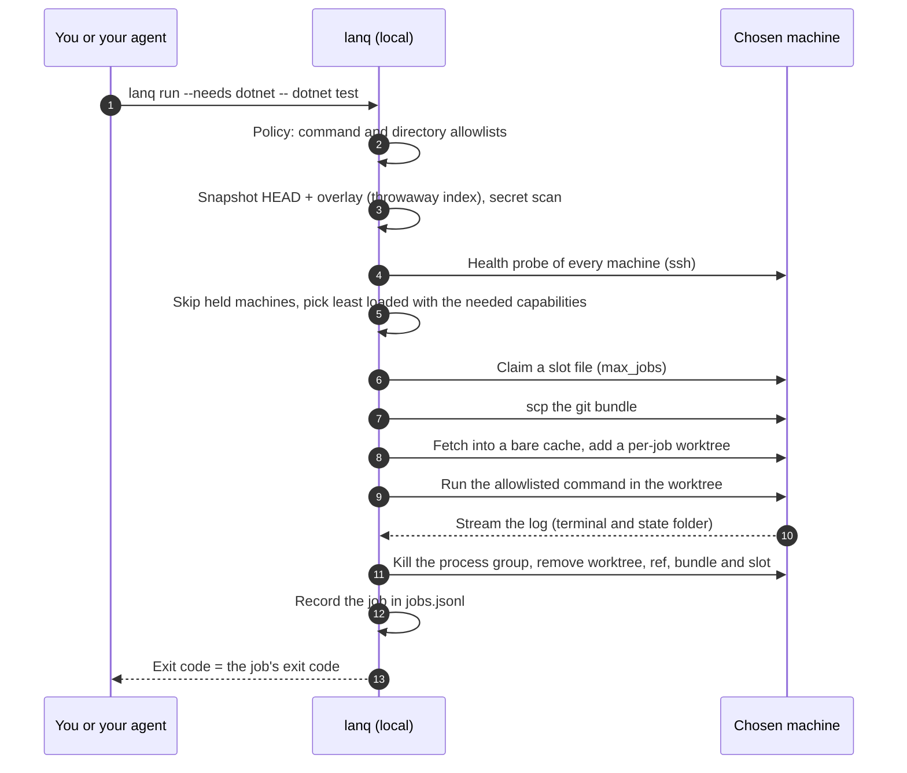

<p align="center"></p>

# LanQueue

**RAM and new hardware are expensive. Your old PCs are not. Plug them back in and give them work.**

`lanq` is a small .NET global tool that sends builds, tests, log analysis and headless coding-agent jobs to the other
computers you already own: the old desktop in the closet, the spare laptop, the small-form-factor box. Your old
machines can still help you get development done. All a worker needs is a LAN connection, SSH, git (or just `tar`, see
[Transfer modes](#transfer-modes-git-default-recommended-or-archive)) and the toolchain for your jobs, and it joins
your queue. Your dev PC stays free for writing code. Even a PC too old or locked down to install git can help: SSH,
tar and your toolchain are enough.

```bash
dotnet tool install --global LanQueue      # update later: dotnet tool update --global LanQueue
```

No .NET SDK? Each release also has a single-file native `lanq` for Windows, Linux (glibc 2.27 and later) and macOS,
and a Scoop manifest; see [Install](#install).

**Setting up a pool for a team?** [docs/TEAM-QUICKSTART.md](docs/TEAM-QUICKSTART.md) walks through one orchestrator
and a mix of Windows 10/11 and Linux workers, low-RAM micro PCs and overnight family PCs included, from `lanq init` to
the first job, with the ten most common errors and their fixes.

A 3-command taste (after you list your machines once in `machines.yml`, see [Quick start](#quick-start)):

```bash
lanq health                                                        # which machines are awake and free?
lanq run --needs dotnet,linux -- dotnet test -c Release            # run on the least loaded match
lanq stats                                                         # how long did jobs take?
```

For each job it checks which machines are awake and not busy, picks the least loaded one that has what the job
needs, ships your current git state (HEAD plus uncommitted changes) to a throw-away worktree over key-only SSH, runs
one allowlisted command, streams the log back, cleans up, and records how long it took. It is headless and
scriptable, it has no daemon and no server to install on the remote machines (just `ssh`, `git` or `tar`, and a shell), and it
sends nothing anywhere except to the hosts you list. There is no telemetry.

## Why this exists

This is the author's first-hand account, not a benchmark. The author works on two projects (a .NET API and a web
front end) from one dev PC. One overnight run put two heavy agent-driven build/test jobs, the local dev stack and a
scheduled task on that single machine at the same time. The local API crashed, the front-end dev server broke, a
task expected to take an hour or two took most of an afternoon, and the failures that night were machine load, not
code defects.

The fix was organisational before it was technical: allow one heavy job at a time on the dev PC, and send builds
and tests to two spare machines on the LAN (a build box and a small-form-factor PC) over key-only SSH, so the dev PC
stays free for writing code and orchestrating. Along the way the author hit the usual remote-Windows traps (stale
incremental builds after file overlays, "Filename too long" in deep worktrees, quirks of running tests over SSH).
`lanq` is that routine turned into a tool.

`lanq stats` reads a local log of every job: per machine and per command the counts, median and p90 times, each
machine's speed factor, and how long a command's work and per-shard overhead are. There are no published measurements
yet, and this README makes no speed-up claim.

## Install

On the machine you run `lanq` from you need `git` and `ssh`/`scp` on the PATH. Remote machines need an SSH server
(Linux: `sh`; Windows: OpenSSH Server with PowerShell 5.1+) and either `git` (the default) or `tar` (with
`transfer: archive`). Then pick one of three ways to get `lanq` itself:

| Way | Needs | Upgrade |
| --- | --- | --- |
| [Native binary](#native-binary-no-net-needed) from GitHub Releases | nothing else | download the new one |
| [Scoop](#scoop-windows) (Windows) | Scoop | `scoop update lanq` |
| [.NET tool](#net-tool) from nuget.org | the .NET 10 SDK | `dotnet tool update --global LanQueue` |

### Native binary (no .NET needed)

From 0.5.0 each release has a single-file, ahead-of-time compiled `lanq` for five targets. Each archive holds `lanq`
(`lanq.exe` on Windows), `LICENSE` and `THIRD-PARTY-NOTICES.txt`; put `lanq` anywhere on your PATH.

| Asset | Runs on |
| --- | --- |
| `lanq-win-x64.zip` | Windows x64 (the Windows versions .NET 10 supports) |
| `lanq-win-arm64.zip` | Windows 11 on Arm64 |
| `lanq-linux-x64.tar.gz` | Linux x64 with glibc 2.27 or later (Ubuntu 18.04, Debian 10, RHEL 8 and newer) |
| `lanq-linux-arm64.tar.gz` | Linux Arm64 with glibc 2.27 or later (Raspberry Pi OS 64-bit, Ubuntu 18.04 and newer) |
| `lanq-osx-arm64.tar.gz` | macOS on Apple silicon |

The Linux binaries are linked against Microsoft's .NET 10 build sysroot (Ubuntu 18.04, glibc 2.27), not against the
build machine's newer glibc, and every release runs them inside an Ubuntu 18.04 container before publishing. glibc
2.27 is .NET 10's own floor; there is no musl (Alpine) or 32-bit build. On macOS, a file downloaded with a browser is
quarantined; `xattr -d com.apple.quarantine lanq` clears that (the binary is ad-hoc signed, not notarized).

```bash
# Linux x64 example: download, verify (see below), install
gh release download --repo jangolath/lanqueue --pattern 'lanq-linux-x64.tar.gz' --pattern SHA256SUMS
sha256sum --check --ignore-missing SHA256SUMS
gh attestation verify lanq-linux-x64.tar.gz --repo jangolath/lanqueue
tar -xzf lanq-linux-x64.tar.gz lanq && install -D -m 755 lanq ~/.local/bin/lanq   # ~/.local/bin must be on PATH (most distros add it at next login)
lanq --version
```

On Windows, check the hash in PowerShell with `(Get-FileHash lanq-win-x64.zip -Algorithm SHA256).Hash` and compare it
with the line for that file in `SHA256SUMS`, or use `gh attestation verify` as above.

A native binary carries its own copy of the .NET runtime, so a .NET security fix reaches it only through a new
`lanq` release (see [SECURITY.md](SECURITY.md)). The .NET tool instead uses the runtime installed on your machine.

### Scoop (Windows)

Every release attaches a Scoop manifest, `lanq.json`, that pins that release's zip URLs and SHA-256 hashes. There is
no bucket to add:

```powershell
scoop install https://github.com/jangolath/lanqueue/releases/latest/download/lanq.json
scoop update lanq      # later
```

Scoop remembers the URL an app was installed from and reads the manifest from it again on `scoop update` and
`scoop status`, so because that URL always points at the latest release, `scoop update lanq` moves to new versions.
`scoop search` does not find `lanq` (it is in no bucket), and `scoop update` needs to reach GitHub. To stay on one
version, install from that release's URL instead, for example
`https://github.com/jangolath/lanqueue/releases/download/v0.10.1/lanq.json`. Scoop checks each zip against the hash in
the manifest; the manifest itself is covered by `SHA256SUMS` and the release's attestation. Release candidates
(tags such as `v0.5.0-rc.1`) are published as GitHub prereleases, which `releases/latest` never points at, so the
`latest` URL never installs one.

### .NET tool

Requires the .NET 10 SDK.

```bash
dotnet tool install --global LanQueue
dotnet tool update --global LanQueue       # later, to upgrade
```

Package: [nuget.org/packages/LanQueue](https://www.nuget.org/packages/LanQueue). The tool package is
framework-dependent (it runs on the .NET runtime you have) and behaves exactly like the native binary: both read the
config through the same compile-time (source-generated) YAML and JSON code. Prefer to build it yourself? From a clone:

```bash
dotnet pack src/LanQueue -c Release -o ./nupkg
dotnet tool install --global --add-source ./nupkg LanQueue
```

To build a native binary yourself (needs the platform's C toolchain, see
[Native AOT prerequisites](https://aka.ms/nativeaot-prerequisites)):

```bash
dotnet publish src/LanQueue -c Release -r linux-x64 -p:LanqNative=true -o ./native
```

### Verify a release

Every release asset is covered by one `SHA256SUMS` file and by a GitHub build-provenance attestation (signed with the
release workflow's OIDC identity, logged in the public Sigstore transparency log). `sha256sum --check` proves a
download is intact; `gh attestation verify` also proves it was built from this repository by the release workflow:

```bash
gh release download v0.10.1 --repo jangolath/lanqueue
sha256sum --check SHA256SUMS
for f in *.zip *.tar.gz *.nupkg lanq.json SHA256SUMS; do gh attestation verify "$f" --repo jangolath/lanqueue; done
dotnet tool install --global --add-source . LanQueue --version 0.10.1    # the attested package, if you want the tool
```

From 0.4.0 the `.nupkg` is attested; from 0.5.0 every asset is. The copy on nuget.org carries nuget.org's own
repository signature, so its bytes differ from the attested file; verify the GitHub Release asset. Dependencies are
pinned too: every project commits a `packages.lock.json` (the native build has its own, `packages.native.lock.json`),
CI restores in locked mode, and every GitHub Action and build container is pinned to a full SHA or digest.

## Quick start

Before your first job, each worker needs an SSH server, git (or only `tar` in archive mode) and the toolchain your jobs use; it does **not** need
GitHub access, Docker (unless your jobs use it) or lanqueue itself. Checklist and setup steps:
[docs/WORKERS.md](docs/WORKERS.md). No Linux machine? A Windows PC with Docker Desktop can run one in a container
([a Linux worker in Docker](docs/WORKERS.md#a-linux-worker-in-docker-on-your-own-pc)).

1. Write a starter config with `lanq init`: it goes to the per-user file lanq reads without flags
   (`~/.config/lanq/machines.yml`, or `$XDG_CONFIG_HOME/lanq/machines.yml`; on Windows `%APPDATA%\lanq\machines.yml`),
   never into the current folder, and prints the path. Or copy `machines.example.yml` there, and edit it: the
   repository's `machines.example.yml` is only a template, and lanq never reads it. A config in the current directory is
   never picked up implicitly; for another file pass `--config FILE` or set `LANQ_CONFIG` (`lanq init` then writes that
   file).
2. Make sure key-based login works and the host key is already in `known_hosts`. With a key loaded in ssh-agent
   (recommended, see [Keeping your keys safe](#keeping-your-keys-safe)): `ssh user@build-01.lan true`.
3. Check your setup and the fleet (`lanq doctor --remote` also checks each worker's tools; see [Commands](#commands)):

   ```
   $ lanq health
   build-01       OK    load 0.12  cores 8  ram 15.6 GB  disk free 180.4 GB  mem free 9.8 GB (swap 2.0 GB)  slots free 2/2  suited: heavy: full suites and large builds
   build-02       HOLD  load 0.05  cores 4  ram 7.8 GB  disk free 90.1 GB  mem free 5.1 GB  slots free 1/1  suited: medium: test shards and builds (outside allowed hours)
   build-03       DOWN  build-03.lan refused the connection: its SSH server is not running, or a firewall rejects the ssh port (Windows: Start-Service sshd and Set-Service sshd -StartupType Automatic; Linux: sudo systemctl enable --now ssh) (ssh: ssh: connect to host build-03.lan port 22: Connection refused)
   ```

   Each line shows the machine's size (cores, total RAM, free/total slots, what it is suited for; see
   [Sharding](#sharding-long-work-across-the-pool)), and a machine that does not answer says what to fix, quoting
   ssh's own line.

4. Run something from inside a git repository:

   ```bash
   lanq run --needs dotnet,linux --dir tests -- dotnet test -c Release
   ```

   The job's exit code becomes `lanq`'s exit code. `--wait 120` keeps retrying for up to 120 seconds when every
   machine is busy or on hold, and may wake a sleeping machine that has a `wake:` setting as a last resort
   (`--no-wake` prevents that; see [Wake-on-LAN](#waking-a-sleeping-worker-wake-on-lan)). `--timeout 60` stops the job after 60 minutes (default 240). `--mem 4` sends the job
   only to a machine that reports at least 4 GB of available memory. `--fetch 'TestResults/**/*.trx'` brings test
   results, coverage or build output back after the job (see [Fetching results](#fetching-results---fetch)). `lanq stats`
   summarises your local job log.

Exit codes: the job's own code; `2` rejected by policy or bad arguments; `70` infrastructure error (SSH, git);
`75` no eligible machine; `124` the job ran past `--timeout`, or past the end of its machine's `allowed_hours` plus
the grace period, and was stopped. A job that itself exits with `124` gives the same code; the last stderr line tells
them apart (`[lanq] TimedOut: timed out after N min`, `[lanq] WindowClosed: stopped after N min: ...` versus
`[lanq] Failed: exit 124`).

`75` covers two cases, and `--json` tells them apart with `retryable`. `true`: machines are busy, held, asleep or
unreachable, so waiting may help. `false`: no machine can ever take the job as configured (none has every `--needs`
capability, `--mem` is above every machine's total RAM, ...). Then lanq ends at once, without waiting out `--wait` or
waking anything, and the message starts `No eligible machine, and no machine can ever take this job as configured
(waiting will not help).` To see the choice before a run, use `lanq run --dry-run` or `lanq health --needs a,b`.

## Commands

| Command | What it does |
| --- | --- |
| `lanq health [--json] [--wake]` | Probes every machine (one ssh call each, in parallel): load, cores, RAM, disk, memory, free slots, what it is suited for, holds, and what to fix when ssh fails. `--wake` also wakes machines that look asleep. |
| `lanq health --needs a,b [--mem GB] [--size C[,C] \| --min-size C] [--json]` | Also judges every machine for such a job by the rules `lanq run` uses: `-> eligible (2 slots)` or `-> not eligible: lacks gpu (...)`. Exit `0` when at least one machine could take it now, `75` when none could. |
| `lanq health --on m[,m] [--json]` | Shows only the named machines. |
| `lanq run --needs a,b [--dir D] [--wait S] [--timeout M] [--mem GB] [--fetch PATTERN ...] [--no-wake] [--json] -- CMD...` | Runs one allowlisted command on the best machine and returns its exit code; `--fetch` brings files back; `--no-wake` never wakes a sleeping machine for it. |
| `lanq run ... --size light,medium -- CMD...` or `lanq run ... --min-size heavy -- CMD...` | Only machines of that size class (`--size`: one of the listed classes; `--min-size`: that class or larger). A machine's `size:` in `machines.yml` wins over its probed size; see [Routing jobs](#routing-jobs). |
| `lanq run ... --on m[,m] -- CMD...` | Only the named machines (an unknown name is refused before any network). Every other rule still applies. |
| `lanq run ... --env NAME=VALUE ... -- CMD...` | Sets a variable for this job only; the name must be in `policy.allowed_env`. See [Job variables](#job-variables---env). |
| `lanq run ... --exclusive -- CMD...` | Takes every slot of the machine, so nothing else runs there meanwhile. See [Exclusive jobs](#exclusive-jobs---exclusive). |
| `lanq run ... --baseline [--baseline-ref REF] -- CMD...` | After a failure, runs the same command at the base commit and says whether the failure is new. See [Is this failure new?](#is-this-failure-new---baseline) |
| `lanq run --plan [--plan-file PATH] [--only a,b] [--fail-fast] [--dry-run] [--json]` | Runs the jobs of the repository's `lanq.yml` side by side on one snapshot, ordered by `after:`, with one result; see [docs/PLANS.md](docs/PLANS.md). Since 0.10.0 also `--on`/`--size`/`--min-size` (narrow every job, never widen), `--plan-timeout M` (the whole plan's limit) and `--fetch-dir`/`--fetch-max`/`--fetch-max-files` (for every fetching job). |
| `lanq run ... --json --log-tail N -- CMD...` | Adds the last N lines (1 to 200) of the job's log to the JSON object as `logTail`; `logPath` is always there. |
| `lanq run ... --dry-run [--json] -- CMD...` | Says what `lanq run` would do now (the checks, the snapshot scan, the machine, every excluded machine and why, `--shards` N and placement) and does none of it. |
| `lanq run --shards N\|auto [--shard-retries R] [--fail-fast] ... -- CMD {shard}/{shards}` | Splits one command into N jobs that run at once across free slots; see [Sharding](#sharding-long-work-across-the-pool). |
| `lanq run --shards auto --target-minutes M ... -- CMD {shard}/{shards}` | Picks N from earlier runs of the same command so each shard takes about M minutes (1 to 1440), never more than the free slots; see [docs/SHARDING.md](docs/SHARDING.md#choosing-n-from-history---target-minutes). |
| `lanq stats [--json] [--target-minutes M]` | Summarises your local job log: totals, per machine (median and p90 of completed jobs, speed factor), per command (runs, results, the work and per-shard overhead) and, since 0.10.0, per plan job (per plan file and job name; one run per plan run), and the size of the job logs. `--target-minutes M` adds the shards M would need. |
| `lanq doctor [--remote [--force]] [--json]` | Checks your own setup without any network; `--remote` also checks each worker over ssh. `--json` prints one object with every check and its fix. |
| `lanq makeready <machine>` or `lanq makeready --ssh user@host --os windows\|linux [--key-env VAR] [--json] [--force]` | Runs the read-only [lanq-makeready](https://github.com/jangolath/lanq-makeready) check on a worker and suggests a `machines.yml` entry. `--key-env VAR` scans with the key file whose path is in `VAR`. |
| `lanq makeready --ssh user@host --os windows\|linux --setup [--key-env VAR]` | Prints the PC's full one-time setup (build user, your public key, work folder, firewall, password logins off, the fingerprint check) and connects to nothing. |
| `lanq makeready --ssh user@host --os windows\|linux --add --name NAME [--key-env VAR] [--yes] [--json]` | Scans the PC and, only when it is READY, adds it to your `machines.yml` (it shows the lines and asks first; `--yes` without a terminal). |
| `lanq makeready --all [--json] [--force]` | The same check on every configured machine, four at a time, as one summary table. |
| `lanq init [--json]` | Writes a commented starter `machines.yml` to the per-user config file (or to `--config FILE` / `$LANQ_CONFIG`), never into the current folder; never overwrites a file. |
| `lanq unlock <machine> [--all --yes]` | Removes slot files a crashed `lanq` left behind. |
| `lanq wake <machine> [--wait] [--json]` | Sends a Wake-on-LAN magic packet to a machine with a `wake:` setting, even outside its `allowed_hours`; `--wait` waits for ssh. |
| `lanq --version` | Prints the version (with its commit) and the embedded lanq-makeready version. |

Every command takes `--config FILE`. An option a command does not use is an error, not silently ignored.

### lanq doctor

Local by default (no network): `ssh` (with its version), `scp`, `git` and `ssh-keygen` on PATH; the state folder is
writable; the config loads (the loader's own error otherwise); the job logs in `logs/` (count and size, `WARN` over
2 GB when `policy.keep_logs_days` is 0); and for each machine a `known_hosts` entry (host and
port resolved with `ssh -G`, so `~/.ssh/config` counts; a non-22 port is looked up as `[host]:port`, and a
`HostKeyAlias` is looked up as it is; the user and global known_hosts files `ssh -G` names are searched), the `key_env`
file and whether it has a passphrase. `--remote` first probes each machine like `lanq health`: a machine that is
paused (PAUSE file) or outside its `allowed_hours` gets a `HOLD` line and nothing else is run there (`--force` checks
it anyway; `HOLD` lines do not change the exit code). Then one ssh call per machine, four at a time: is `work_root`
writable (a temporary file, removed again; a missing `work_root` is a warning and is not created), is git or tar
there for the machine's transfer mode, and does each capability's tool answer **in the job environment**, with the
machine's `env:` and `path_prepend:` applied exactly as for a job. Each check may take 20 seconds; a check that hangs
is stopped (Linux `timeout`, Windows a child PowerShell whose tree is killed) and reported as timed out, and the
other checks still run. On a git machine a worker git older than 2.32 is a `WARN` (see "Hardened git"):

| Capability | Command run |
| --- | --- |
| `dotnet` / `node` / `npm` | `dotnet --version` (fails without an SDK) / `node --version` / `npm --version` |
| `python` | `python3 --version`, falling back to `python --version` |
| `go` | `go version` with `GOTOOLCHAIN=local` (never downloads a toolchain) |
| `rust` / `java` | `cargo --version` with `RUSTUP_AUTO_INSTALL=0` (never installs a toolchain) / `java -version` |
| `docker` | `docker version --format '{{.Server.Version}}'` (the daemon must answer) |

Other capability names are listed as `SKIP ... not checked`. This is how you find the classic "npm works when I log
in, but `npm: not found` in a lanq job" problem: a non-login SSH session does not run your shell profile, so add the
tool's folder to `path_prepend:`. When the `dotnet` check fails, doctor also searches the worker's install folders
(read-only, a few seconds; [docs/WORKERS.md](docs/WORKERS.md#toolchain-in-a-non-standard-place)) and, when it finds an
SDK somewhere the job's `PATH` does not reach (say `D:/build/dotnet`), the fix names the exact `path_prepend:` and
`DOTNET_ROOT` lines to add. On a Windows worker whose build account is denied WMI, a `wmi` line is a `WARN` with what
the owner could grant; lanq works without it ([docs/WORKERS.md](docs/WORKERS.md#windows-workers-where-wmi-is-denied)).
Output is one `OK`, `WARN`, `FAIL` or `SKIP` line per check; the exit code is `0` when nothing is `WARN` or `FAIL`,
otherwise `1`.

```
$ lanq doctor --remote
OK    ssh: OpenSSH_9.6p1, OpenSSL 3.0.13 30 Jan 2024
OK    git: git version 2.47.0
OK    config: 2 machine(s)
OK    logs: 388 files, 96.2 MB (kept 30 days)
OK    build-01: known_hosts has build-01.lan
OK    build-01 (remote): dotnet: 10.0.100
FAIL  build-01 (remote): npm: 'npm --version' failed in the job environment (sh: 1: npm: not found). If the tool is installed, ...
SKIP  build-01 (remote): gpu: not checked (no known tool command)
```

`--json` (also with `--remote`) puts those lines on stderr and prints one object on stdout: `status` (`Ok`,
`Warnings`, `Failing`, ...), `exitCode`, `counts` and one entry per line in `checks`, each with a `name`, `level` and,
where there is one, a `fix`:

```bash
$ lanq doctor --remote --json 2>/dev/null | jq -c '.checks[] | select(.level == "fail")'
{"scope":"remote","machine":"build-01","name":"capability","level":"fail","detail":"npm: 'npm --version' failed in the job environment (...)","fix":"add the tool's folder to path_prepend for this machine","capability":"npm"}
```

The check names and every field are in [docs/JSON.md](docs/JSON.md#lanq-doctor---json).

### lanq makeready

Runs [lanq-makeready](https://github.com/jangolath/lanq-makeready) on a worker: a read-only check of SSH, git/tar,
.NET 10, Docker and overnight readiness (sleep, pending reboots, update restarts). The script is built into `lanq`
(v0.4.1, byte-identical to that release, whose SHA-256 a test pins; only the read-only scanner: lanq-makeready's fix
script is never built in or sent), sent on ssh **stdin** and run from memory with
`-Redact` / `--redact`: nothing is written to the worker's disk, and nothing on it is changed.

- `lanq makeready build-01` for a configured machine. It respects the machine's `PAUSE` file and `allowed_hours`
  (exit `75`); `--force` scans anyway.
- `lanq makeready --ssh user@old-pc.lan --os windows` for a PC that is not in `machines.yml` yet, once key-based
  SSH works and its host key is in your `known_hosts` (same key-only, strict-host-key ssh options as every other call;
  your agent or default key is used). `--key-env VAR` uses the key file whose path is in `VAR` instead, as `key_env:`
  does, and the suggested entry then carries `key_env: VAR`. When the worker refuses the key or its host key is not in
  `known_hosts` yet, lanq also suggests `--setup` (below).

It prints the verdicts (`worker_git`, `worker_archive`, `dotnet10`, `docker`, `overnight`), then the script's own
`VERDICT:` line (`READY`, `READY WITH WARNINGS (n)` or `NOT READY (n blockers)`) and its numbered next steps, blockers
first, each with the command or settings path to use and whether it needs admin (or root), worded as the script prints
them, and a `Suited for:` line (light, medium or heavy, "+ container builds" when Docker answers). A report from
lanq-makeready 0.1 has none of these: lanq then lists each `WARN`/`FAIL` check with its advice. Then, for a configured
machine, the capabilities detected but not configured and configured but not detected, and a suggested `machines.yml`
entry: `max_jobs` and `min_free_mem_gb` sized from the PC's RAM and CPUs, and, only when the script's Wake-on-LAN check
passed, a commented `wake:` block to uncomment (the MAC is redacted in the report, so fill in `mac:`). When a `WARN`/`FAIL` check may be one that lanq-makeready's
fix script fixes (Windows: `ssh.start`, `ssh.auto`, `power.sleep`, `longpaths.on`, `git.longpaths`, `ssh.aclkeys`;
Linux: `ssh.start`, `power.sleep`), one more line names those fixes: *May be fixable at that PC (lanq-makeready-fix:
power.sleep, longpaths.on): its owner can run lanq-makeready-fix.ps1 -WhatIf there to see what it can do, local and
interactive only (see lanq-makeready's README). lanq never runs it.* (`sh lanq-makeready-fix.sh --dry-run` on Linux.)
"May": the fix script has its own preconditions and can still decline. (Since 0.9.1; not in `--json`.) It ends with: *lanq never changes a worker. Fixes are for the PC's
owner to run on that PC.* `--json` prints the validated report (schema `lanq-makeready/v1`) instead (0.2.0's
`summary`, `suitedFor`, `min_free_mem_gb` and `wake` included), every string sanitised and `suggestedMachine.path_prepend`/`env`
kept only as the one usable folder with `DOTNET_ROOT` set to it, anything left out named in `lanqWithheld` (0.9.2; also in `--all` and `--add --json`); when there is no report it prints exactly
one `{"status":...,"exitCode":...,"message":...}` object (`Rejected` 2, `InfraError` 70, `Held` 75, `Cancelled` 130). The report is
treated as untrusted input: at most 1 MB, parsed without reflection, checked against the schema, every string
sanitised before display, and nothing in it is ever run. Exit codes: `0` worker-ready (git or archive transfer works),
`1` not ready, `2` bad arguments, `70` ssh failed or the report was unusable, `75` machine paused or outside its hours,
`130` Ctrl+C.

`lanq makeready --all` runs the same check on every machine in the config, four at a time, with the same rules (a
paused machine or one outside its `allowed_hours` is not scanned unless `--force`; the script goes on ssh stdin), and
prints one table:

```text
$ lanq makeready --all
lanq makeready --all: 4 machine(s), read-only (lanq-makeready 0.4.1)

MACHINE    OS       VERDICT      TOP PROBLEM
micro-01   linux    WARN 1       Pending reboot: a restart is pending
micro-02   windows  FAIL 1       OpenSSH Server: not installed
family-pc  windows  held         paused (a PAUSE file is in its work_root); --force scans anyway
micro-03   linux    unreachable  ssh: connect to host 10.20.30.33 port 22: Connection timed out

Details, advice and a suggested machines.yml entry for one machine: lanq makeready <machine>
lanq never changes a worker. Fixes are for the PC's owner to run on that PC.
```

The verdict is `FAIL n` only when the machine is NOT READY (no transfer mode works, so `lanq makeready <machine>` exits
`1`), with n blockers; else `WARN n` with n things to look at, else `OK`. A `FAIL` check that does not stop the PC being
a worker (Docker, .NET) is one of the warnings, as in the script's own verdict. The counts and the top problem come from
the report's summary (lanq-makeready 0.2.0: its first next step, blockers first); for a 0.1 report, from its checks (the
first failing check, else the first warning). `unreachable` (the probe or ssh failed), `held` or `error` (the report was
unusable) when there is no report, with why as the top problem. Exit codes, first match wins: `70` any machine was
unreachable or its report unusable (the check is incomplete); `1` any machine is NOT READY; `75` any was held; `0`
otherwise. Warnings alone exit `0`, as `lanq makeready <machine>` does; they stay in the table and the JSON. `2` means bad arguments or config, `130` Ctrl+C. With `--json` it prints exactly
one object, `{"status":"Ok|Failing|InfraError|Held","exitCode":...,"machines":[...]}`, where each machine has `machine`,
`os`, `verdict` (`OK`, `WARN`, `FAIL`, `unreachable`, `held` or `error`), `warnings`, `failures` (blockers), `exitCode` (what
`lanq makeready <machine>` would exit with), `problem` (absent when there is none) and `report`: the validated
`lanq-makeready/v1` report exactly as `lanq makeready <machine> --json` prints it (absent without one). A bad argument
or config prints the usual `{"status":"Rejected","exitCode":2,"message":...}` object instead.

#### Adding a machine: --setup and --add

Two steps add a new PC. Both write only on your computer; lanq still never changes a worker.

`lanq makeready --ssh build@10.20.30.21 --os windows --setup` (or `--os linux`) prints the PC's full one-time setup and
connects to nothing: the build user (the `build` of `build@...`, not an administrator; `root` and `administrator` are
refused), your public key in its `authorized_keys` (Windows: `icacls` with every grant by SID and inheritance cut;
Linux: `.ssh` 700 and `authorized_keys` 600), the work folder (`C:/lq` or `/srv/lq`, the `work_root` lanq makeready
suggests), firewall scoping, the command that shows the host key fingerprint, the first connection from your computer
(compare the fingerprint before answering yes), and password logins off once the key works. The PC's owner runs the
worker part. The key is the first one `ssh-add -L` lists, else `~/.ssh/lanq_ed25519.pub`, else `~/.ssh/id_ed25519.pub`;
with `--key-env VAR`, only the `.pub` beside the key `VAR` names. lanq reads only `.pub` files and checks each key
line; without a usable key the commands hold a placeholder and the output says how to make one. Text only (`--json` is
refused), exit `0`. [docs/TEAM-QUICKSTART.md](docs/TEAM-QUICKSTART.md#3-set-up-each-worker) explains every step.

`lanq makeready --ssh build@10.20.30.21 --os windows --add --name micro-01` then scans the PC as `lanq makeready --ssh`
does and, only when it is READY (with or without warnings), adds its entry to your `machines.yml` (found as for every
command, or `--config FILE`):

- Before the scan it checks the arguments, that the config loads, that no machine has that name (ignoring case) or
  that host, and that it can edit the file by itself: one YAML document, one block-style top-level `machines:`, no
  tabs, not a link. Otherwise it refuses (exit `2`) and you paste the entry by hand.
- The entry goes in as text after the last machine (before `lanq init`'s commented examples), lined up with the file's
  own items. Every other byte, CRLF or LF and a BOM are kept. The lines it shows are the lines it writes.
- It checks the result before writing (it loads, holds exactly one machine more, the others are unchanged), then
  replaces the file atomically (keeping its Unix mode, or its ACL on Windows), never through a link and never over a
  file that changed meanwhile.
- It asks first on a terminal. Without one, and always with `--json`, it needs `--yes`.
- Then one read-only probe of the new machine (never a wake), printed as a `lanq health` line, a warning when
  `lanq init`'s `example-01` is still there, and `Next: lanq doctor --remote`.

Exit `0` added; `1` NOT READY or declined (nothing written); `2` bad arguments, config, a duplicate or a file it does not
edit; `70` ssh failed, the report was unusable or the file could not be written. `--json` prints one object (see
[docs/JSON.md](docs/JSON.md#lanq-makeready---add---json)).

### lanq init

`lanq init` writes a commented, minimal `machines.yml` to the per-user config file that lanq reads without flags
(`%APPDATA%\lanq\machines.yml` on Windows, `~/.config/lanq/machines.yml` elsewhere; `$XDG_CONFIG_HOME` is honoured),
or to `--config FILE` or `$LANQ_CONFIG` when given, creating the folder. It never writes into the current folder (which
may be a repository; since 0.8.0, earlier versions wrote `./machines.yml`). Text and JSON say the path written.
It never overwrites a file and never writes through a link: an existing file, folder or link (even one
pointing nowhere) at that path is refused (exit `2`). The file loads as written: a policy memory floor suited to
small PCs (`min_free_mem_gb: 1.5`), one live example machine to replace (`max_jobs: 1`, set per machine), and commented examples of a
Windows micro PC (`key_env`, a memory floor, heap caps) and a Linux family PC (`allowed_hours`, `wake:`). It then
prints the next steps: `lanq makeready --ssh user@host --os windows|linux --setup` for each worker's one-time setup
(see [Adding a machine](#adding-a-machine---setup-and---add)), `lanq makeready --ssh user@host --os windows|linux --add
--name NAME` to add each one once it is ready, delete `example-01`, then `lanq doctor --remote`. Remember that lanq
never reads `./machines.yml` by itself: the steps include `--config` with the file's path unless you wrote it to the
per-user path. `--json` prints one object (`{"status":"Created","exitCode":0,"path":...,"message":...,"nextSteps":[...]}`;
`Rejected` 2 when the file exists, `InfraError` 70 when it could not be written) and sends the next steps to stderr.

### lanq unlock

A slot file records its deadline; `lanq run` reclaims a slot 30 minutes after it. `lanq unlock build-01` removes
the slots that are already past their deadline right away and says what it removed and what it kept (a live slot,
or one written by a lanq before 0.4, which has no deadline). `lanq unlock build-01 --all --yes` removes every slot
file on that machine, including those old ones; a job still running there keeps running but loses its slot, so
another job may start beside it. `--all` without `--yes` is refused.

### Fetching results (--fetch)

```bash
lanq run --needs dotnet --dir tests --fetch 'TestResults/**/*.trx' --fetch '**/coverage.cobertura.xml' -- dotnet test --logger trx
```

After the job ends, whether it passed, failed, timed out or was stopped by its machine's hours, and before the job
folder is deleted, `lanq` copies the files that match back to `.lanq/artifacts/<job id>/` in your repository (the
`.lanq` folder is never sent to a worker and gets a `.gitignore`), keeping their relative paths. Nothing is fetched
when the job never started.

- A pattern is relative to the job's working folder (`--dir`), uses forward slashes, and only `*` (within one name),
  `?` (one character) and `**` (a whole segment: any number of folders). Absolute paths, drive letters, `..`,
  backslashes, `:` and a leading `-` are refused, as is any character outside letters, digits, space and
  `. _ + @ = , ~ - /`. `--fetch` may be given up to 16 times. On a Windows worker patterns match ignoring case.
- Only regular files are fetched. Symlinks, junctions and other reparse points (never followed, not even as folders),
  hard-linked files (Linux), devices, FIFOs, names with control characters and anything that resolves outside the job
  folder are skipped and listed with the reason.
- Caps: 500 files and 200 MB in all by default; `--fetch-max-files N` (up to 5000) and `--fetch-max SIZE` (for example
  `500M` or `1G`, up to `2G`) change them. Files are taken in sorted order until a cap is hit; the rest are listed as
  skipped.
- `--fetch-dir DIR` writes to `DIR/<job id>/` instead.
- The fetch has its own 10-minute limit, and on a machine with `allowed_hours` it never runs more than 2 minutes past
  the end of the window plus grace.
- A job that timed out or was stopped by its window can still be running on the worker (which enforces the limit
  itself a minute later), so before fetching `lanq` stops it the way cleanup does: the recorded process group on
  Linux, and on Windows only the recorded processes whose pid and start time still match. A job that completed or
  failed is not touched.
- A job whose ssh connection dropped while it ran (`InfraError`) may also still be running there: `lanq` stops it the
  same way on a fresh connection and fetches what it left (cleanup would kill it next anyway). If the machine does not
  answer that either, nothing is fetched and `fetchError` is "not fetched: the SSH connection failed during the job".
  ssh reports a lost connection as exit 255, which a job can also exit with; the job wrapper therefore ends its output
  with a `LANQ_EXIT=<job id>:<code>` line (taken off the output), and a 255 counts as the job's own exit only when that
  line is the final one and says 255; otherwise it is a lost connection. The line decides nothing else: any other exit
  code is ssh's, and a marker-shaped line that is not the last one is shown as ordinary output. A job that exits 255
  itself is `Failed` with exit 255.
- Each file is written as a short `.lanq-partial-N` file in the same folder and renamed to its name only once its size and hash are right.
  Anything the worker prints on stderr during the fetch is shown as `[lanq] fetch stderr: ...` (the first 10 lines,
  sanitised) and never mixed into the files.
- **Fetch problems never change the exit code**: the job's result is what `lanq` reports, and a skipped or failed file
  is listed in the summary (and in `--json`). A job that passed but whose results did not come back is still a passed
  job; check `fetchError` and `fetchSkipped` when the files matter.

The summary goes to the job output (stderr with `--json`):

```text
[lanq] fetch (the job failed (exit 1)): 2 file(s), 1.4 MB -> /home/me/src/app/.lanq/artifacts/20261109-221503-a1b2c3
[lanq]   fetched TestResults/unit.trx (1.3 MB)
[lanq]   fetched TestResults/coverage.cobertura.xml (96.2 KB)
[lanq]   skipped TestResults/latest.trx: symbolic link, junction or reparse point (never followed)
```

The worker is treated as untrusted for this step; see [Security model](#security-model).

### Test results (--results)

```bash
lanq run --needs dotnet --dir tests --results trx:TestResults/*.trx -- dotnet test --logger trx
lanq run --needs node --results junit:reports/junit.xml -- npx jest --reporters=default --reporters=jest-junit
```

Since 0.11.0 `--results trx:PATTERN` or `junit:PATTERN` (in `lanq.yml`: `results: { format: trx, path: ... }`) names
the results files the job writes. The pattern is a `--fetch` pattern and is fetched too (it counts as `--fetch`,
unless a `--fetch` already names it), so the fetch rules, limits and fields all apply. After the fetch, `lanq` counts
the tests in the fetched files that match: VSTest TRX (xUnit, NUnit, MSTest) or JUnit XML (pytest, jest-junit,
Maven Surefire and most others). The job output gets the reader's warnings, `[lanq] results: 120 tests, 118 passed,
1 failed, 1 skipped` and up to 10 `[lanq]   failed NAME` lines; `--json` gets a `results` object.

When a job **completed** but its results show no test executed (no file matched, or every test was skipped), `lanq`
prints `[lanq] warning: no tests ran: 0 executed in 0 results file(s) (results path TestResults/*.trx)` before the Next
lines and adds an `ask_developer` step: a wrong filter or test project would otherwise pass silently. It is
information only: the status and exit code never change (a sharded job is judged after its shards are merged; a
single empty shard never warns). Making it fail is planned as an opt-in (see
[docs/PLANS.md](docs/PLANS.md#make-no-tests-ran-fail)). Test names are data the worker wrote, sanitised: never run them.

### JSON output

Scripts and coding agents should prefer `--json`; [docs/JSON.md](docs/JSON.md) is the full contract.
`lanq health --json` prints one array, in config order:

```json
[{"name":"build-01","state":"ok","reasons":[],"load":0.12,"diskFreeGb":180.4,"memFreeGb":9.8,"slotsUsed":0,"maxJobs":2,"localTime":"2026-11-09T22:15:03","cores":8,"memTotalGb":15.6,"loadKnown":true,"freeSlots":2,"size":"heavy","sizeSource":"probe","suitedFor":"heavy: full suites and large builds","nextSteps":[{"action":"none","reason":"build-01 can take work","safeToRunUnattended":false}]},
 {"name":"build-02","state":"hold","reasons":["outside allowed hours"],"load":0.05,"diskFreeGb":90.1,"memFreeGb":null,"slotsUsed":0,"maxJobs":1,"localTime":null,"cores":4,"memTotalGb":null,"loadKnown":true,"freeSlots":1,"size":"unknown","sizeSource":"probe","suitedFor":"unknown: the machine did not report its memory","nextSteps":[{"action":"wait","reason":"build-02 is outside allowed hours; it takes jobs again in its next window (allowed hours: Mon-Fri 22:00-07:00)","safeToRunUnattended":false}]}]
```

`state` is `ok`, `hold` or `down`; `reasons` is empty when `ok`; `memFreeGb` and `localTime` (the worker's own clock)
are `null` when the worker does not report them; so are `cores` and `memTotalGb` (then `size` is `unknown`).
`freeSlots` is `maxJobs` minus the live slots in use (0 for a machine that is down); since 0.9.0 `slotsStale` (only when above 0) counts the slots in `slotsUsed` that a crashed run left more than 30 minutes past their deadline, which the next claim reclaims, and `size` is `light`, `medium`, `heavy`
or `unknown`: the machine's `size:` in `machines.yml` when it has one (`sizeSource` `config`), else the probed class
(`sizeSource` `probe`). `loadKnown` is `false` only when a Windows worker could not measure its load at all (then
`load` means nothing). With `--needs a,b`, `--mem GB`, `--size` and/or `--min-size`, each row also has `eligible`, `why` and `reason` (null when
eligible), `permanent` (waiting can never change it) and `jobSlots` (how many copies or shards of such a job it could
take now, `--mem` counted per copy); without them the rows are exactly as above.

`lanq run --json` streams the job's output to **stderr** and prints one object on stdout when it is over:

```json
{"status":"Completed","exitCode":0,"machine":"build-02","jobId":"20261109-221503-a1b2c3","durationSeconds":84.2,"message":"exit 0","logPath":"/home/me/.local/state/lanq/logs/20261109-221503-a1b2c3.log","nextSteps":[{"action":"none","reason":"the job completed","safeToRunUnattended":false}]}
```

`logPath` is always there: the full path of the job's local log (every line lanq printed for the job), `null` when no
job started. `--log-tail N` (1 to 200, `--json` only) adds `logTail`, the log's last N lines (sanitised, empty when no
job started), so a script or agent needs no stderr redirect to see why a job failed. In text mode lanq prints
`[lanq] log: <path>` on stderr just before the status line. On `NoCapacity` the object adds `retryable` (`false` when no
machine can ever take the job, so waiting will not help) and `excluded`, one `{machine, reason, why, permanent}` per
machine; `reason` is a code such as `missing_capability` or `busy` ([the table](docs/JSON.md#reason-codes)).

With `--fetch` the object also has `fetched` (`[{"path":"TestResults/unit.trx","bytes":1363148,"sha256":"..."}]`) and
`fetchSkipped` (`[{"path":"TestResults/latest.trx","reason":"..."}]`), both present and possibly empty on every path
(also when the job never started, the command line was refused or the config could not be read), plus `fetchDir` when a fetch ran, `fetchError` when the fetch as a whole had a
problem (timed out, cut short, the machine's hours ended, the ssh connection was lost) and `fetchSkippedMore` when more than 200 files were skipped.
Without `--fetch` none of these keys appear. `--results` counts as `--fetch`; since 0.11.0 it also adds `results` (the
counts, `noTests`, at most 50 `failedTests` and warnings) whenever the job ran, as the last key
([docs/JSON.md](docs/JSON.md#results-conditional-0110)).

Since 0.9.0, with `--env` the object has `env` (the variable names, never their values); with `--exclusive`,
`"exclusive":true`; and with `--baseline`, after a failure, a `baseline` object (`ref`, `sha`, `status`, `exitCode`,
`machine`, `jobId`, `logPath`, `durationSeconds`, `verdict`, `message`). Each is left out when it does not apply
([docs/JSON.md](docs/JSON.md#baseline)).

`status` is `Completed`, `Failed`, `Rejected`, `NoCapacity`, `InfraError`, `TimedOut`, `WindowClosed` or `Cancelled`;
`exitCode` is `lanq`'s own exit code; `machine` is `null` when no machine took the job. Stdout always carries exactly
one such object, also when the job never started: bad arguments or a config error (`Rejected`, `2`, `jobId` `null`),
Ctrl+C (`Cancelled`, `130`) or an unexpected error (`InfraError`, `70`). `lanq health --json` with a bad argument or
config prints `{"status":"Rejected","exitCode":2,"message":...,"nextSteps":[...]}` instead of its array, and `Cancelled`
(`130`) or `InfraError` (`70`) objects of the same shape when interrupted or broken. The `[lanq] ...` status line
and error messages still go to stderr, and so does the usage text after an unknown command (`lanq --help` prints it
on stdout). `lanq run --dry-run --json` prints one object with `status` `WouldRun` (exit `0`) or the status the run
would end with, the machine, every machine as judged for the job and, with `--shards`, N and the placement.
`lanq run --plan --json` prints one object for the whole plan with a `jobs` array (one entry per job, by name), and
`lanq run --plan --dry-run --json` one with each job's `lanq run` line and what it would do
([docs/JSON.md](docs/JSON.md#lanq-run---plan---json)); with a plan limit both add `planTimeoutMinutes`, and a plan
that reached it adds `planTimedOut: true`.
`lanq doctor --json` prints one object with every check (see [lanq doctor](#lanq-doctor)), and `lanq stats --json` one
object with the totals, `machines`, `commands` (each with its `timing`), `planJobs` and `logs`.

**`nextSteps`.** Every `--json` object (each `lanq health` row, the run, dry-run, init, wake, doctor, stats,
`makeready --all` and `--add` objects and every error object) carries `nextSteps`, at least one entry:
`{"action","reason","command"?,"argv"?,"safeToRunUnattended"}`. `action` is `proceed`, `retry`, `wait`, `fix_code`,
`fix_command`, `ask_developer`, `run_doctor`, `run_health` or `none`; treat one you do not know as `ask_developer`.
`argv` is the exact command and is authoritative; `command` is the same as one line for bash and PowerShell, left out
when an argument cannot be written safely for both. A suggestion never does more than the command that produced it,
and only `safeToRunUnattended: true` steps are for a script or agent to run by itself. The one exception is the single
`lanq makeready <machine> --json` report, which stays the lanq-makeready script's own report with no `nextSteps` (its
error objects have them). For people, the same steps are printed as `Next: ...` lines on stderr (`[lanq] Next: ...`
inside `lanq run`), before the status line, which stays last. The full contract is in
[docs/JSON.md](docs/JSON.md#nextsteps).

## How it works



Where each safety check sits (numbers are the diagram steps):

| Step | Check |
| --- | --- |
| 2 | Command and directory must match your allowlists; permission-skipping flags are refused. Nothing has touched the network yet. |
| 3 | The command line and the uncommitted overlay are secret-scanned, and committed file names are checked; a hit refuses the job before anything is sent. |
| 4-5 | Machines that are unreachable, paused, loaded, outside their hours (or about to close), low on disk or memory, under memory pressure or missing a capability are skipped. |
| 6 | `max_jobs` is enforced with an atomic slot file per machine; a slot left by a crashed run counts as stale 30 minutes after its recorded deadline: it no longer makes the machine busy, and the next claim reclaims it. |
| 4-10 | Every ssh/scp call is key-only, non-interactive and uses `StrictHostKeyChecking=yes`. |
| 11 | Cleanup runs even when the job fails, is cancelled or times out (best effort if the network is down). |

### The steps in words

1. The command and directory are checked against your policy. Rejected jobs never touch the network.
2. HEAD plus uncommitted and untracked, non-ignored files are snapshotted into a commit using a temporary index
   (your index, branches and working tree are untouched) and bundled. The overlay is scanned for secrets.
3. Every machine is probed; those that are unreachable, over the load threshold, outside their hours, full or
   missing a required capability are skipped. The rest are ranked by load.
4. A slot file is claimed atomically on the chosen machine (`max_jobs` per machine), the bundle is uploaded with
   `scp`, fetched into a bare cache repo, and a detached `git worktree` is created for the job.
5. The command runs in the worktree; output streams to your terminal and to `<state>/logs/<job>.log`, where
   `<state>` is `$LANQ_HOME` or a per-user folder (`%LOCALAPPDATA%\lanq`, or `~/.local/state/lanq`), never your repo.
6. With `--fetch`, the matching files are streamed back as checksummed text and written below
   `.lanq/artifacts/<job id>/`.
7. The worktree, ref, bundle and slot are removed, even if the job failed. One line about the job is appended to
   `<state>/jobs.jsonl`. Any `.lanq/` folder in the repository is excluded from the snapshot.

### Local state

lanq keeps its state on your computer, in `<state>` (`$LANQ_HOME`, else `%LOCALAPPDATA%\lanq` on Windows, else
`$XDG_STATE_HOME/lanq` or `~/.local/state/lanq`). Nothing in it leaves this machine.

- `jobs.jsonl`: one JSON line per finished job: `id`, `machine`, `command`, `startedUtc`, `wallSeconds`, `exitCode`
  and `status`, and since 0.7.0 `v` (2), `key` (the command; for `--shards` its arguments with `{shard}` and
  `{shards}`), `dir`, `shard`, `shards` and `runId` (shared by the shards of one run), and `runSeconds` (how long the
  command itself ran, without the wait, upload, prepare, fetch or cleanup), and since 0.8.0 `planJob` and `planRun`
  for the jobs of a `lanq run --plan` (the job's name in `lanq.yml`, and an id shared by one plan run), and since 0.9.0
  `envNames` (the names of the job's `--env` variables, never their values), `exclusive` and, on a `--baseline` rerun,
  `baselineOf` (the failed job's id) and `commit` (the base commit's short id), and since 0.10.0 `planFile` on a plan
  job (the plan file's full path; `lanq stats` groups plan jobs by it, so clones in different folders count
  separately). A field that does not apply is left out. Baseline reruns ran another commit, so `lanq stats`, `--target-minutes` and a plan's order leave them out.
  At 4 MiB the file moves to `jobs.1.jsonl` (replacing the one before), so there are at most two files; lanq reads
  both, and lanq 0.6 reads only `jobs.jsonl`. `jobs.jsonl.lock` makes two lanq processes take turns writing. A job
  that cannot be recorded (the file is locked for long) gets a warning; its result does not change. A line lanq cannot
  read is skipped and counted by `lanq stats`.
- `logs/<job id>.log`: every line lanq printed for a job. After a run, at most once a day, lanq deletes its own logs
  older than `policy.keep_logs_days` (default 30; 0 never deletes) and the oldest beyond 5,000. It never deletes a log
  modified in the last hour, a link or any other file, and a prune that takes over 2 seconds stops and carries on
  after the next run. `lanq doctor` and `lanq stats` show the count and size.
- `bases.json` (which git bases each worker has) and `tmp/` (scratch for bundles and archives).

`lanq stats`, `--target-minutes` and the speed factors read only these files. Do not edit or delete `jobs.jsonl` or
`logs/` while lanq runs; to start over, delete `jobs.jsonl` and `jobs.1.jsonl` when no lanq is running.

## Transfer modes: git (default, recommended) or archive

Each machine in `machines.yml` has an optional `transfer` setting:

- **`git`** (the default, recommended): `lanq` sends a git bundle and the worker keeps one bare cache repo per
  repository (`<work_root>/repos/<repoid>.git`, named after the first 16 hex digits of the root commit) with a
  detached worktree per job. Later jobs on the same worker are cheaper to prepare. The worker needs `git`. (Versions
  before 0.4 used a single shared `<work_root>/repo.git`; it is no longer used and can be deleted.)
- **`archive`**: `lanq` builds the same snapshot (HEAD plus uncommitted and untracked files, honouring `.gitignore`,
  never `.lanq/`) on your PC and sends it as a `tar.gz`; the worker extracts it into a fresh per-job folder with its
  own `tar`: GNU tar (with gzip) on Linux, or the bsdtar built into Windows 10 1803+ / Server 2019+. **The worker does
  not need git at all**, so the old PC that cannot or should not have git installed still joins the queue: SSH + tar +
  your toolchain. A worker whose `tar` is busybox tar (Alpine and many minimal images) is refused, because its
  listing cannot be trusted; install GNU tar there or use `transfer: git`.

Everything else is identical in both modes: the allowlists, forbidden flags and secret scan run on your PC before
anything is sent, the directory checks and process-group kill apply to the job folder, and cleanup removes the job
folder, the upload and the slot. Archive mode copies the files, not history, so a job that needs git metadata (for
example one that runs `git log` or `git describe`) should run on a `git` machine. Symlinks and submodules are
skipped, not archived (only regular files and directories are), and the job output reports how many were skipped.
Paths that Windows cannot store (names ending in a dot or space, the characters `<>:"|?*`, or device names such as
`CON`, `NUL` or `COM1`) make the archive build fail with the offending path and rule, because any worker could be a
Windows one.

### Incremental bundles (git mode)

The first job for a repository on a machine sends a full bundle. After a worker has fetched a snapshot, `lanq`
records the commit it was taken on in `<state>/bases.json` (per machine and repository; written atomically), and the
worker's cache keeps `refs/lanq/base` on that snapshot so the objects stay put. The next job bundles only what is new
(`git bundle create … --not <base>`), as long as the base is still a local ancestor of the new snapshot. The worker
runs `git bundle verify` before fetching; if its cache no longer has the base (for example it was deleted), the job
falls back once to a full bundle automatically and the log says so. Rewritten history (rebase, amend, reset) or a
missing `bases.json` simply mean a full bundle; deleting `bases.json` is always safe. A `--baseline` rerun of an older
commit leaves the worker's newer base (and `bases.json`) as it was, so the next normal job stays incremental.

`lanq health` checks `git --version` on `git` machines, and on `archive` machines that `tar` is GNU tar or bsdtar
(plus `gzip` on Linux), and holds a machine that lacks the tool, with the reason.

## Sharing a machine with the people who use it

An old PC is often still someone's PC: a family desktop, a partner's laptop, the kids' homework machine. Four
settings keep `lanq` a polite guest there (a full example is the "family PC" entry in `machines.example.yml`):

- **Hours by day.** `allowed_hours` takes one window or a list, each `[Days ]HH:mm-HH:mm`:

  ```yaml
  allowed_hours:
    - "Mon-Fri 22:00-07:00"    # weeknights; a window that crosses midnight belongs to the day it starts
    - "Sat,Sun 01:00-09:00"    # Mon..Sun, ranges with '-', lists with ','
  ```

  Times are the worker's own clock (the probe reports it); a worker that does not report one is checked against your
  PC's clock and `lanq health` shows `time: local`. A machine whose window ends within `policy.min_window_minutes`
  (default 10) takes no new job ("window closing"). A job still running when the window ends gets
  `policy.window_grace_minutes` (default 15) more, then it is stopped and cleaned up like a timeout: exit `124`,
  status `[lanq] WindowClosed`.
- **A PAUSE switch anyone can use.** If a file named `PAUSE` exists in the machine's `work_root`, `lanq` holds the
  machine ("paused on the machine") and starts nothing there. No lanq knowledge needed:
  - Windows: in a Command Prompt, `type nul > C:\lq\PAUSE` (use your `work_root`), and `del C:\lq\PAUSE` to
    resume. Friendlier: put two desktop shortcuts on that PC, "Pause builds" with the target
    `cmd /c type nul > C:\lq\PAUSE` and "Resume builds" with the target `cmd /c del C:\lq\PAUSE`.
  - Linux: `touch /srv/lq/PAUSE` to pause, `rm /srv/lq/PAUSE` to resume.

  The person needs write access to the `work_root` folder (grant it once, or make the shortcuts for an account that
  has it). Only the file's existence counts; its content is ignored. On Linux the name is `PAUSE` or `pause` (those two
  spellings only, since Linux file names are case-sensitive); on Windows any case works.

  **A job that is already running is not affected**: PAUSE only stops new jobs from starting there. To end a running
  job now, stop `lanq run` on your PC (Ctrl+C), which cleans the job up on the worker.
- **Low priority (the default).** `priority: low` runs the job with `nice -n 10` and `ionice -c3` on Linux (when they
  exist and work) and at BelowNormal priority on Windows (inherited by every process the job starts), so the person
  at the keyboard keeps a responsive machine. Set `priority: normal` on a dedicated build box.
- **Memory.** See the next section.
- **Wake-on-LAN** for a PC that sleeps outside its hours. See below.

### Waking a sleeping worker (Wake-on-LAN)

A family PC that is asleep or off outside its `allowed_hours` can be woken by `lanq` when its window opens. Opt in per
machine:

```yaml
    wake:
      mac: "aa:bb:cc:dd:ee:ff"       # required; aa:bb:cc:dd:ee:ff or aa-bb-cc-dd-ee-ff
      broadcast: 10.20.30.255        # optional IPv4 literal; default 255.255.255.255
      port: 9                        # optional, 7 or 9 (default 9)
      wait_seconds: 120              # optional, 1 to 600 (default 120): how long to wait for ssh after the packet
```

`broadcast` must be `255.255.255.255` or a private (10.x, 172.16-31.x, 192.168.x) or link-local (169.254.x) IPv4
address; a public, multicast, loopback or `0.0.0.0` address is refused when the config loads (this is a LAN tool).
**On a computer with several network cards, a VPN or WSL, the default `255.255.255.255` may leave through the wrong
interface: set `broadcast` to the directed broadcast of the worker's own subnet** (for `10.20.30.0/24`, that is
`10.20.30.255`).

- **`lanq run` wakes a machine only as a last resort.** If no awake machine can take the job now, and you gave a real
  `--wait` (above 0), `lanq` wakes **one** machine: the first by name among those that look asleep, have a `wake:`
  setting, have the capabilities the job needs, could take its arguments (a Windows machine is skipped for arguments
  Windows cannot take) and are inside their `allowed_hours` with at least `policy.min_window_minutes` plus the machine's
  `wake.wait_seconds` of the window left (10 min + 120 s by default): a machine with less left would be held as "window
  closing" once awake, so it is left asleep and the reason is shown. Nothing is woken while an awake machine can take the job,
  with `--wait 0` (the default), or with `--no-wake`. The wake happens inside `--wait`: it never makes `lanq run`
  wait longer than you asked, and the other machines keep being tried meanwhile. At most once per machine per `lanq`
  invocation, and not another machine while one is still coming up.
  When every awake machine that fits the job is merely busy, `lanq` may therefore wake a sleeper for extra capacity; use
  `--no-wake` to avoid that. If a woken machine never answers, the next eligible sleeper (by name) may be tried once the
  first one's `wait_seconds` have passed, still within `--wait` and with at most one packet per machine per run.
- **`lanq health` stays read-only and quick.** It never wakes anything by itself. `lanq health --wake` sends a packet
  to every machine that looks asleep and is inside its hours with that much of its window left, then waits for each (probing again after 5 s, 10 s, then
  every 20 s, up to `wait_seconds`).
- **What counts as asleep:** ssh itself said, on its own `ssh: connect to host ...` line, that the connection timed out
  or the host or network is unreachable (the Windows OpenSSH wordings are recognised too). A refused connection (the PC
  is up, sshd is not), an authentication failure or a host-key failure never wake a machine. A localized (non-English)
  ssh message is not recognised, which fails safe: the automatic wake does not fire, and `lanq wake` still works.
- **Hours and the PAUSE file.** A sleeping PC cannot report its own clock or a `PAUSE` file, so the hours check before
  a wake uses **this computer's clock and time zone**; on a daylight-saving night it may be an hour off. A paused
  machine that is awake is reported as paused and never woken, but a PC that is already asleep may well be paused: it
  will be woken, then held as "paused on the machine" once it answers.
- **Explicit**: `lanq wake build-02` sends the packet whatever the hour, because you asked for that machine by name,
  and says so. `--wait` then waits for ssh and exits 0 when it answers, 1 when it does not within `wait_seconds`. With
  `--json` it prints one object, `{"status":"Sent|Awake|NoAnswer","exitCode":0,"machine":...,"sent":true,"awake":null|bool,"durationSeconds":...,"message":...}`, or the usual
  `{"status":"Rejected|InfraError|Cancelled","exitCode":...,"message":...}` when nothing was sent.
- `lanq doctor` reports the wake setting. It cannot tell whether the machine will actually wake: Wake-on-LAN has to be
  enabled in the BIOS/UEFI and the network card driver, and usually only works on wired Ethernet. See
  [docs/WORKERS.md](docs/WORKERS.md#wake-on-lan-for-a-sleeping-worker). The packet is unauthenticated and only meant
  for your LAN (see [SECURITY.md](SECURITY.md)).

## Old machines with little RAM

`lanq health` reports each machine's available memory (Linux `MemAvailable` and free swap, plus memory pressure
from `/proc/pressure/memory` where the kernel has it; Windows free physical memory). A machine is held when:

- it has less than `policy.min_free_mem_gb` available (default 1.0; a machine can set its own `min_free_mem_gb`):
  "low memory (0.8 GB free)";
- on Linux, the PSI `some avg10` figure (the share of the last 10 seconds in which tasks stalled waiting for memory)
  is above `policy.max_mem_pressure` (default 20): "memory pressure".

A machine that does not report memory (an older kernel, an unusual host) is not held for it. A job that needs a lot
of memory can ask: `lanq run --mem 6 ...` goes only to a machine that reports at least 6 GB available, and never to
one that cannot report it.

How many jobs a machine should take at once follows its RAM and CPUs: `max_jobs` 1 under 6 GB, 2 under 12 GB, 3
under 24 GB (4 with 8+ CPUs), else 6 (8 with 16+ CPUs), never above the CPU count, and `min_free_mem_gb` 1.5 under
6 GB, else 2. `lanq makeready` suggests exactly that; the table and the reasons are in
[docs/SHARDING.md, Sizing machines](docs/SHARDING.md#sizing-machines), and the other small-PC settings in
[docs/TEAM-QUICKSTART.md](docs/TEAM-QUICKSTART.md#8-sizing-micro-pcs).

Build tools size themselves to the machine, which on a 4 GB box usually means swapping. Cap them per machine with
`env:` (set for the job only):

```yaml
env:
  DOTNET_GCHeapHardLimitPercent: "0x32"        # .NET: GC heap at most 50% of RAM (the value is hexadecimal)
  NODE_OPTIONS: "--max-old-space-size=2048"    # Node: 2 GB heap
  CARGO_BUILD_JOBS: "2"                        # Rust: two parallel compile jobs
```

For .NET builds the parallelism is a command-line switch, not an environment variable: `dotnet build` and
`dotnet test` build several projects at once by default (MSBuild's `-maxcpucount`, `-m`); on a small machine run
them as `dotnet build -m:1` and `dotnet test -m:1` (one build process). The allowlist entries `dotnet build` and `dotnet test`
already allow the extra argument.

Tools installed per user (nvm, pyenv, rustup, sdkman) are often missing in a non-login SSH session, because they put
themselves on `PATH` from `.bashrc` or `.profile`. List their folders under `path_prepend:` and the job finds them:

```yaml
path_prepend:
  - /home/build/.nvm/versions/node/v22.11.0/bin
  - /home/build/.cargo/bin
```

The same goes for a toolchain in a private folder, for example a .NET SDK in `D:/build/dotnet` on a Windows worker
whose `PATH` only has a runtime-only dotnet: `path_prepend: [D:/build/dotnet]` plus `DOTNET_ROOT: D:/build/dotnet`
under `env:`. `lanq doctor --remote` finds such a folder and prints these lines; lanq never edits `machines.yml` itself.

`env:` names must be letters, digits and `_`; values may not be empty (Windows PowerShell 5.1 cannot set an empty
variable, so an empty value is refused everywhere: leave the variable out) or contain control characters. As a
best-effort guard against mistakes (the config's author is trusted), names that can hijack the program loader or a
shell are refused (`LD_*`, `DYLD_*`, `GLIBC_TUNABLES`, `BASH_ENV`, `ENV`, `SHELLOPTS`, `BASHOPTS`, `PS4`,
`PROMPT_COMMAND`, `PSModulePath`, `COMSPEC`, `PATHEXT`), and `PATH` is set only through `path_prepend` (absolute
directories; a drive path such as `C:/Users/build/.cargo/bin` on Windows). Values reach the job as data: on Linux each
`NAME=value` is one single-quoted word passed to `env`, on Windows a single-quoted PowerShell string, so quotes,
`$( )` or backticks in a value are never run.

`env:` here is per machine and set by you. For a setting one job needs (a configuration, a test filter), use
[`--env`](#job-variables---env) instead. A machine whose `env:` sets the same name is not used for that job.

## Sharding long work across the pool

A long test suite can run as N pieces at once, one per free slot, while your dev PC keeps working:

```bash
lanq run --needs node --shards 4 -- npx jest --shard={shard}/{shards}
lanq run --needs node --shards auto -- npx playwright test --shard={shard}/{shards}
lanq run --needs rust --shards 4 -- cargo nextest run --partition slice:{shard}/{shards}
```

- `--shards N` (1 to 64) starts N jobs of one command, each with its own job id; `--shards auto` uses the number of
  free slots on the machines that can take the job now (and says why). A machine with `max_jobs: 4` takes up to four
  shards at once, a `max_jobs: 1` micro PC one.
- `{shard}` (1-based) and `{shards}` are replaced by numbers in the arguments only, and each job also gets `LANQ_SHARD`
  and `LANQ_SHARDS`. Every shard's command line passes the allowlist, the permission-flag ban and the secret scan before
  anything is sent.
- The repository is snapshotted once and each bundle or archive built once for all shards. Shards beyond the free
  slots wait for a sibling to finish; `--wait` counts only while no shard of the run holds a slot. `--mem` is per
  shard: a machine takes at most as many shards as its free memory covers.
- Output lines are prefixed `[i/N machine]`, and a summary table ends the run. Exit 0 only if every shard passed;
  otherwise the failing shard's own code, else 2, 124, 70 or 75. `--json` prints one object with a `shards` array.
- `--fail-fast` cancels the rest after the first shard that fails; `--shard-retries R` (0 to 3) re-runs only a shard
  whose machine stopped answering, never a test failure. Ctrl+C cancels every shard and cleans each one up.
- `--dry-run` with `--shards auto` shows the N it would pick and where each shard would start, and runs nothing.
- `--shards auto --target-minutes M` picks N from earlier completed runs of the same command, so each shard takes
  about M minutes on the slowest machine it would go to, never more than the free slots. Without history it is plain
  `--shards auto`. See [Choosing N from history](docs/SHARDING.md#choosing-n-from-history---target-minutes); lanq
  picks N, and the test runner decides which tests go in each shard
  ([recipes](docs/SHARDING.md#balancing-shards-recipes)).

`lanq health` also shows each machine's cores, total RAM, free/total slots and what it is suited for (light under
6 GB, medium 6 to under 16 GB, heavy 16 GB or more with 4+ cores, "+ container builds" with a `docker` capability);
`health --json` adds `cores`, `memTotalGb`, `freeSlots`, `size` and `suitedFor`.
[docs/SHARDING.md](docs/SHARDING.md) has per-ecosystem recipes (.NET, Node, Python, Go, Rust), a sizing table for
`max_jobs` and `min_free_mem_gb`, and a worked plan for 2 dev boxes and 4 micro PCs; setting up the pool itself is in
[docs/TEAM-QUICKSTART.md](docs/TEAM-QUICKSTART.md).

## Routing jobs

Most jobs need only `--needs` (capabilities, all required). In a pool of small and big machines two more options and
a plan file pick where a job may go; each only narrows the choice, and every other rule (capabilities, `--mem`, holds, allowed
hours, slots, wake) still applies:

- `--min-size heavy` (that class or larger) or `--size light,medium` (one of these): by machine size. A machine's size
  is its `size:` in `machines.yml` when it has one, else the probed class (light under 6 GB; heavy 16 GB or more with
  4+ cores; else medium; see [Sizing machines](docs/SHARDING.md#sizing-machines)). Declare `size: medium` on a 16 GB
  laptop someone works on to keep heavy jobs off it, or a size on a machine that cannot report its memory. A machine of
  another size can never take the job (`wrong_size`), nor can one with no declared size that does not report its
  memory (`size_unknown`).
- `--on big-01,build-01`: only the named machines. An unknown name is refused (exit 2) before any network. A pinned
  machine that is busy or held makes the job wait (`NoCapacity`, retryable); one that can never take it ends the run
  at once (`retryable: false`).
- A plan file, `lanq.yml`, sets these per job, so `lanq run --plan` sends builds and unit tests to the small machines
  and the integration suite to the big ones in one command: [docs/PLANS.md](docs/PLANS.md).
- Since 0.10.0 `--on`, `--size` and `--min-size` also work with `--plan`. They narrow every job: a job's own `on:` is
  intersected with `--on`, and its size classes with yours. They never widen a job. A job they leave with no machine
  ends the plan before anything is sent (`NoCapacity`, 75, `retryable: false`). The suggested rerun's `--only` then
  lists the jobs that can still run (never one whose `after:` prerequisite was narrowed out), replacing any `--only`
  you gave; it leaves jobs out, so it is not safe for an agent to run unattended. A coding agent may narrow a plan,
  asks you before such a rerun, and never edits `lanq.yml` to widen a job.

```bash
lanq run --needs dotnet --size light,medium -- dotnet test tests/Unit -m:1
lanq run --needs dotnet --min-size heavy --shards 2 -- sh scripts/lanq/test-shard.sh tests/Integration
lanq health --needs dotnet --min-size heavy        # which machines could take it, and why not the others
lanq run --plan --dry-run                          # what lanq.yml would do now
lanq run --plan --on big-01 --dry-run              # the same, every job narrowed to big-01
```

`lanq health --json` shows each machine's effective `size` and where it came from (`sizeSource`: `probe` or `config`);
for a machine with `size:` the text line adds both, for example `(size: medium in machines.yml; probe: heavy)`.

## Job variables (--env)

Since 0.9.0 a job can set its own environment variables, for settings such as the build configuration or a test
filter. You decide which names jobs may set, in `machines.yml`:

```yaml
policy:
  allowed_env: [CONFIGURATION, TEST_FILTER, "MYAPP_*"]   # exact names, or a prefix ending in *
```

```bash
lanq run --needs dotnet --env CONFIGURATION=Release --env MYAPP_SEED=42 -- dotnet test
```

The job sees `CONFIGURATION` and `MYAPP_SEED`; with `--shards` every shard does. In `lanq.yml` the same is `env:`
(see [docs/PLANS.md](docs/PLANS.md#environment-variables-env)). The variables are set after the machine's own `env:`
and before lanq's `LANQ_*`, quoted as data like the machine's values.

What is refused, and why:

- **A name not in `policy.allowed_env`** (`Rejected`, 2, an `ask_developer` step): "--env TEST_FILTER is not in
  policy.allowed_env (your machines.yml)". The list is empty by default, so every `--env` is refused until you list
  names. A repository's `lanq.yml` comes with the code and can set only the names you allowed.
- **A name on lanq's deny table** (2), even when `allowed_env` lists it. These variables can make an allowlisted
  command run other code, trust another server, or move where tools read their config:
  - the program loader and shell startup: `LD_*`, `DYLD_*`, `BASH_ENV`, `ENV`, `PS4`, `IFS`, `CDPATH`, `PATH`, ...;
  - runtime startup hooks and module paths: Node (`NODE_OPTIONS`, `NODE_PATH`), .NET (`DOTNET_STARTUP_HOOKS`,
    `DOTNET_ROOT*`, `DOTNET_HOST_PATH`, `CORECLR_*`, `COR_*`, `COMPLUS_*`), Java (`JAVA_TOOL_OPTIONS`, `JAVA_OPTS`,
    `CLASSPATH`, ...), Python (`PYTHONSTARTUP`, `PYTHONPATH`, ...), Perl and Ruby;
  - toolchains and build tools: Go (`GOFLAGS`, `GOROOT`, `GOPROXY`, ..., `CC`, `CXX`, `CGO_*`), Rust (`RUSTFMT`,
    `RUSTUP_TOOLCHAIN`, `RUSTC`, `RUSTDOC`, `RUSTFLAGS`, `RUSTDOCFLAGS`, `RUSTC_WRAPPER`, `RUSTC_WORKSPACE_WRAPPER`,
    `CARGO_ENCODED_RUSTFLAGS`, `CARGO_HOME`, `CARGO_TARGET_*`, `CARGO_BUILD_*`, `CARGO_REGISTRIES_*`,
    `CARGO_SOURCE_*`), Gradle and Maven (`GRADLE_OPTS`, `MAVEN_OPTS`, `MAVEN_ARGS`), `MAKEFLAGS`, `NUGET_PLUGIN_PATHS`,
    `DOTNET_MSBUILD_SDK_RESOLVER_*`, `MSBUILD*`, `GRADLE_USER_HOME`, `MAKEFILES`;
  - TLS trust and proxies: `NODE_TLS_REJECT_UNAUTHORIZED`, `NODE_EXTRA_CA_CERTS`, `SSL_CERT_FILE`, `SSL_CERT_DIR`,
    `REQUESTS_CA_BUNDLE`, `CURL_CA_BUNDLE`, `HTTP_PROXY`, `HTTPS_PROXY`, `ALL_PROXY`, `NO_PROXY`;
  - package indexes and interpreters: every name starting `PIP_`, and `UV_INDEX_URL`, `UV_EXTRA_INDEX_URL`,
    `UV_INDEX`, `UV_DEFAULT_INDEX`, `UV_FIND_LINKS`, `UV_PYTHON`;
  - OpenSSL and glibc module paths;
  - profile and temp folders: `HOME`, `USERPROFILE`, `APPDATA`, `LOCALAPPDATA`, `TEMP`, `TMP`, `TMPDIR`,
    `XDG_CONFIG_HOME`, ...;
  - every name starting `GIT_`, `SSH_`, `NPM_CONFIG_`, `YARN_` or `LANQ_`.

  `NODE_ENV`, `GOOS` and `GOARCH` stay allowed. An `allowed_env` entry the table fully covers (`GIT_*`, `HOME`) stops
  the config from loading (so do `PIP_*`, `CARGO_BUILD_*`, `CARGO_REGISTRIES_*` and `CARGO_SOURCE_*`); a prefix that only partly overlaps (`NODE_*`,
  `UV_*`, `CARGO_*`) loads, and `lanq doctor` notes it with an
  `OK` line: `policy.allowed_env NODE_*: names on lanq's deny list (NODE_OPTIONS, NODE_PATH,
  NODE_TLS_REJECT_UNAUTHORIZED, ...) stay refused` (fix: nothing to change if that is intended; list exact names to
  make it plain). The table is a guard against the obvious routes, not a sandbox. On the command line a deny-table
  hit is a `fix_command` step ("this variable can never be set by a job; drop it or ask the developer"); from
  `lanq.yml` it is `ask_developer` (the developer drops it from that job's `env:`).
- **A value that is empty, has control characters, is over 4,096 characters, or brings the job's variables over 16,384
  in all** (2). Windows PowerShell 5.1 cannot set an empty variable.
- **A value that looks like a secret** (2, the value is never echoed), such as `MYAPP_PASSWORD=...` or a token.
  `--env` is for settings, never secrets: values are visible to other users of the worker (its process list), the dry
  run prints them, and a suggested command in `nextSteps` repeats your command line, values included. The JSON `env`
  field and `jobs.jsonl` list names only.

Two cases rule out a machine rather than the job, both permanent and both judged from the config:

- `env_conflict`: the machine's own `env:` in `machines.yml` sets the same name. Which value would win is a guess, so
  lanq does not use that machine for the job. If every machine that could take the job clashes, the run ends at once
  with `NoCapacity` (75, `retryable: false`) and an `ask_developer` step: "ask the developer: they can drop --env
  CONFIGURATION or remove it from the machine's env (build-01, big-01)".
- `windows_command_too_long`: on a Windows machine, lanq's largest job script for that machine plus the job's
  variables would pass the 8,000-character limit (the check uses the worst-case script, not the job's own
  arguments). The job goes to another machine; if none is left, it is `Rejected` (2) with the length (and, when other
  machines were ruled out by `env_conflict`, each of them and its variable), and the step is `ask_developer`: "ask the
  developer: they can shorten or drop the --env values, or change machines.yml".

`--dry-run` shows the `--env` flags as given (after the secret scan) and every machine they rule out.

## Exclusive jobs (--exclusive)

A job that needs a machine to itself (a benchmark, a load test, a suite that uses fixed ports) can take every slot:

```bash
lanq run --needs dotnet --exclusive --on big-01 --wait 3600 -- dotnet test tests/Perf
```

lanq claims `slot-1` to `slot-<max_jobs>` on the machine, all or nothing, so no other lanq job, yours or anyone
else's, starts there while it runs. A claim that finds any slot taken removes the slots it just created and tries
again later. It also backs out when a live `slot-N` above its own `max_jobs` exists: another developer whose
`machines.yml` gives the same `work_root` a higher `max_jobs` is running a job there. That check is one look when the
claim is made: such a developer can still start a job in a higher slot afterwards, beside the exclusive job. Everyone
who shares a worker should use the same `max_jobs` for it.

- **It waits for an idle machine.** A machine with any live slot in use is `busy` for this job ("busy (slots 1/4;
  --exclusive needs all 4 free)"), and waiting can help. Stale slots (below) do not count. Nothing is reserved for it:
  other jobs keep taking free slots while it waits, so on a machine that is never idle it waits out `--wait` and ends `NoCapacity` (75). Pin it with
  `--on` to a machine that is idle, give it a long `--wait`, or run it in quiet hours.
- **With `--shards`** each shard takes a whole machine. `--shards auto` counts the idle machines that can take the
  job; a fixed `--shards N` above the number of machines that can take it as configured (capabilities, `size:`,
  `--env`) is refused (2) before any network: "--exclusive --shards 6: only 4 machines can take this job". That count
  does not include `--mem` or the Windows-arguments rule, so shards beyond what those leave wait for an idle machine.
- `--mem`, holds, hours, size and every other rule still apply. In a plan, the dry run marks the machine full, so a
  sibling job waits for another machine.

`lanq unlock`, the stale-slot reclaim and `lanq health` treat each of its slots as an ordinary slot.

**Stale slots.** A slot file more than 30 minutes (1,800 seconds) past its recorded deadline was left by a crashed
lanq. Since 0.9.0 the probe counts such slots separately (`slots_stale=`), and they do not make a machine busy, for an
exclusive job or any other: the next claim that passes them reclaims them. `lanq health` shows `slots free 4/4 (4
stale: reclaimed by the next claim)`, `health --json` adds `slotsStale` (only when above 0) while `freeSlots` counts
live slots only, and a busy reason reads `busy (slots 3/4, 1 stale: reclaimed by the next claim)` (for an exclusive
job, `busy (slots 2/4, 1 stale: reclaimed by the next claim; --exclusive needs all 4 free)`).

When a claim reports that it could not reclaim a stale slot, lanq says so once per machine per run and counts that
machine's stale slots as busy for the rest of that run. The claim reports it (`RECLAIM=STUCK slot-N`) only when the
slot's `.reclaim` lock is older than about a minute (a dead reclaimer's), no lock could be made, or the file could not be
moved or deleted. A younger `.reclaim` lock is a reclaim in progress and is not reported, and a claim that simply
lost the slot to another job never marks the machine. The count in the line is the number of slots the claim named:

```text
[lanq] build-01: 1 stale slot could not be reclaimed (a .reclaim lock or file permissions); counting it as busy for this run; lanq unlock build-01 clears it
```

The busy reason then reads `busy (slots 2/2, 1 stale, not reclaimable)` (for an exclusive job, `busy (slots 1/2, 1
stale, not reclaimable; --exclusive needs all 2 free)`); both stale notes can appear together. `lanq health` does not
change. A slot file above `max_jobs` that cannot be read counts as live, on Windows as on Linux.

## Is this failure new? (--baseline)

A red run on your branch raises one question first: did my change break this, or was it broken already?

```bash
lanq run --needs dotnet --baseline -- dotnet test tests/Unit
```

When the job ends `Failed` (its own non-zero exit), lanq runs the same request again (the same command, `--dir`,
`--needs`, size, `--on`, `--env`, `--exclusive`, `--timeout`) on the **base commit**, a clean tree without your
changes, and prints a verdict before the status line:

```text
[baseline] [lanq] the job failed; running the same command at 1a2b3c4 (origin/main) to see whether the failure is new
[baseline build-01] ...
[lanq] baseline: at 1a2b3c4 (origin/main) the same command Failed (exit 1) on build-01 in 75.2s: this failure is pre-existing
[lanq] Next: the job exited 1; read logTail or the log (...) and fix the code; pre-existing: it fails at the base commit too (log: ...)
[lanq] log: /home/me/.local/state/lanq/logs/20261109-221503-a1b2c3.log
[lanq] Failed: exit 1
```

Here the merge-base is the tip of `origin/main`, so the base is named `(origin/main)`; when your branch started
further back it reads `(merge-base with origin/main)`.

- **The base** is the merge-base of HEAD and the default branch: `origin/HEAD`, else `origin/main`, `origin/master`,
  `main`, `master`, the first that exists. `--baseline-ref REF` (a branch, tag or commit; it implies `--baseline`)
  uses the merge-base of HEAD and REF, so a branch that moved on still compares with where you started. On the base
  commit itself with uncommitted changes, the base is HEAD without them.
- **The verdict:** `new` (the base completed), `preexisting` (the base failed too, with any exit code),
  `inconclusive` (anything else: it timed out, found no machine, could not be read or sent, or you pressed Ctrl+C) or
  `skipped` (you are on the base commit with nothing uncommitted, so there is nothing to compare).
- **Information only.** The run's status and exit code never change: a `preexisting` failure is still `Failed` with
  the job's own code. The verdict is in the `[lanq] baseline:` line, the `baseline` object in `--json` and the
  `fix_code` reason in `nextSteps`.
- **When it runs:** only after `Failed`. Never after `TimedOut`, `WindowClosed`, `InfraError`, `NoCapacity`,
  `Rejected` or `Cancelled`, and never after a pass.
- **Shards:** only the failed shards rerun, together, with the same `LANQ_SHARD` and `LANQ_SHARDS`. The base's tests
  may split differently, so read a shard verdict as a hint. **Plans:** a job with `baseline: true` that failed reruns
  after the whole plan has ended; jobs skipped after it do not.
- **Where:** the machine that failed, so that the verdict reflects the commit and not the machine. While that
  machine could take the rerun but is busy, the rerun waits for it for up to 2 looks of about 15 seconds each, never
  past what is left of its own `--wait`, printing `[lanq] waiting for a slot on build-01, where the job failed, before
  taking another machine (look 1 of 2)`. While other reruns of the same run hold slots the line is `[lanq] waiting
  for a slot on build-01, where the job failed (the other baseline reruns hold some)` instead. After that it takes
  any machine that can run it. With `--wait 0`, the default, it does not wait for that machine at all: it takes any machine that can
  run it now, and with none free it ends `NoCapacity`, which makes the verdict `inconclusive`. A machine that is held
  or can never take the job is not waited for.
- **Rerun lines** are prefixed `[baseline]` (`[baseline 2/4]` for a shard, `[baseline unit 2/4]` in a plan). On
  another machine than the one that failed, the JSON has `sameMachine: false` and the message ends `(on big-01, not
  build-01 where it failed: the result may reflect the machine)`.
- **Ctrl+C:** a rerun that has not started yet is `inconclusive: cancelled (Ctrl+C) before it started` (in the JSON,
  `status` `null` if it had not begun, `Cancelled` and 130 if it was waiting for or claiming a slot); one that is
  running is stopped and cleaned up (`inconclusive: cancelled (Ctrl+C); its cleanup ran`, `Cancelled`, 130). The run still exits with
  the job's own code.
- **Cost:** a red run takes about twice as long. That is why it is opt-in.
- **Refused before anything is sent** (2): a REF that is empty, over 256 characters, holds control characters,
  starts with `-` or contains `..` ("--baseline-ref must name one branch, tag or commit (for example --baseline-ref
  origin/main or --baseline-ref v1.2.0)."); a REF that is not a commit; a repository with no commit yet; no default
  branch found; or a history with no common commit. A **shallow clone** (CI often fetches one) that lacks the
  merge-base is not refused, because the job itself can run: the baseline is `inconclusive` ("could not find the base
  commit (shallow clone?)"). Fetch more history (`git fetch --deepen` or `--unshallow`) to get a verdict.
- The base commit is sent like any snapshot, after the committed-name and package-config secret scans; a hit makes the
  baseline `inconclusive` ("the base commit was not sent: Refused: possible secrets in payload (...)", the value never
  shown) and sends nothing. On an archive worker this sends the base commit's files: older files than your snapshot.
- **In `lanq.yml`**, `baseline_ref:` must name a branch or tag (it must resolve under `refs/heads/`, `refs/remotes/`
  or `refs/tags/`): a commit id, `HEAD` or `*_HEAD`, and revision characters (`~ ^ : @ { } \ * ? [` and space) are
  refused with `lanq.yml: job 'x' (line N): baseline_ref must name a branch or tag (a commit can be given on the
  command line with --baseline-ref)`. A repository's file should not be able to pick any old commit to send to a
  worker (an archive worker receives that commit's whole tree); you can still name any commit on the command line.
  How the keys combine is in [docs/PLANS.md](docs/PLANS.md#baseline-is-the-failure-new).
- `--dry-run` prints `Baseline: on failure, rerun at 1a2b3c4 (merge-base with origin/main) (a dry run runs
  nothing)`, or that it would be skipped. Reruns are recorded in `jobs.jsonl` with `baselineOf` and `commit`, and
  left out of `lanq stats` and `--target-minutes`.

The verdict is per job (or shard), not per test: a `preexisting` verdict means the same command failed at the base,
not that the same tests did. Read both logs when it matters.

## Keeping your keys safe

`lanq` never stores or sends your key; it only calls `ssh` and `scp`. The aim is that a synced folder, a stolen
laptop or a leaked log cannot hand someone a way into your build machines.

- **Prefer a passphrase-protected key held by ssh-agent.** Omit `key_env` in `machines.yml` and `lanq` passes no
  `-i`; ssh uses whatever your agent holds (still `BatchMode=yes`, so a missing identity fails fast instead of
  prompting). Create a key with `ssh-keygen -t ed25519` and choose a passphrase.
- **Windows.** The OpenSSH Authentication Agent service is disabled by default. From an elevated PowerShell:
  `Get-Service ssh-agent | Set-Service -StartupType Automatic`, then `Start-Service ssh-agent`, then
  `ssh-add $env:USERPROFILE\.ssh\id_ed25519`. Microsoft's guide suggests backing the key up somewhere safe and then
  deleting the plain file from the machine once it is in the agent.
- **Linux / macOS.** Run an agent and `ssh-add ~/.ssh/id_ed25519`; `ssh-add -l` lists what is loaded and
  `ssh-add -t <seconds>` limits how long a key stays loaded. To share one agent across logins on Linux,
  [keychain](https://www.funtoo.org/Keychain) works: put ``eval `keychain --eval id_ed25519` `` in your shell profile.
- **Hardware-backed keys.** `ssh-keygen -t ed25519-sk` creates a key whose secret lives on a FIDO2 token (touch is
  required by default). It needs a token and FIDO-capable OpenSSH on both ends, and a person to touch it, which
  suits interactive use better than unattended overnight runs.
- **If you must use a key file** (`key_env`): keep it out of every repository and out of synced folders (OneDrive,
  Dropbox, iCloud); restrict it (`chmod 600 ~/.ssh/id_ed25519`; on Windows, in PowerShell `icacls <file> /inheritance:r /grant:r "${env:USERNAME}:F"`, in cmd
  `icacls <file> /inheritance:r /grant:r "%USERNAME%:F"`); and give it a passphrase. `lanq health` warns when a configured OpenSSH-format
  key file opens with an empty passphrase (checked with `ssh-keygen -y -P ""`). Other key formats and `-sk` keys
  are not checked, so no warning is not a guarantee.
- **Use a dedicated low-privilege build user on each worker.** Build tools run project code with that user's
  rights, so give it nothing but its `work_root`. On Windows, a standard (non-admin) user's keys go in
  `~\.ssh\authorized_keys`; administrator accounts use `C:\ProgramData\ssh\administrators_authorized_keys`.
- **Restrict the key on the worker** in that user's `authorized_keys`, for example
  `restrict,from="<your-lan-subnet>" ssh-ed25519 AAAA... lanq-build`. `restrict` turns off port, agent and X11
  forwarding and PTY allocation, none of which `lanq` needs; `from=` accepts CIDR notation, so a stolen key is
  useless off your LAN. Replace the placeholder with your LAN subnet in CIDR form.
- **Secrets that are not the SSH key: PowerShell SecretManagement + SecretStore.** Use them for the key
  *passphrase* and any job tokens: `Install-PSResource Microsoft.PowerShell.SecretManagement` and
  `Install-PSResource Microsoft.PowerShell.SecretStore` (or `Install-Module`), then
  `Register-SecretVault -Name SecretStore -ModuleName Microsoft.PowerShell.SecretStore -DefaultVault`,
  `Set-Secret -Name BuildToken -Secret "..."` and `Get-Secret -Name BuildToken` (add `-AsPlainText` only where you
  must). It is not a home for the SSH key *file*: ssh wants a key file or an agent, while the vault stores
  strings, `SecureString`, `PSCredential`, byte arrays and hashtables for PowerShell to read back. Microsoft
  states these modules are feature-complete and receive security and critical fixes only.

Sources: [Microsoft, key-based authentication in OpenSSH for Windows](https://learn.microsoft.com/en-us/windows-server/administration/openssh/openssh_keymanagement),
[Microsoft, SecretStore getting started](https://learn.microsoft.com/en-us/powershell/utility-modules/secretmanagement/get-started/using-secretstore?view=ps-modules),
[ssh-keygen(1)](https://man.openbsd.org/ssh-keygen.1), [ssh-add(1)](https://man.openbsd.org/ssh-add.1),
[sshd(8)](https://man.openbsd.org/sshd.8).

## Two ways to use it

### As a developer, directly

```bash
lanq health                                                    # who is awake and idle?
lanq run --needs dotnet,linux -- dotnet test -c Release        # exit code is the job's exit code
lanq run --needs dotnet --dir tests --wait 120 -- dotnet test  # wait up to 2 minutes for a free machine
lanq run --needs dotnet --timeout 30 -- dotnet test            # stop the job after 30 minutes (exit 124)
lanq run --needs gpu --dry-run -- dotnet test                  # which machine would take it, and why not the others?
lanq run --needs dotnet --min-size heavy -- dotnet test        # only a heavy machine (--size light,medium, --on big-01)
lanq run --needs dotnet --env CONFIGURATION=Release -- dotnet test   # a job variable (the name must be in policy.allowed_env)
lanq run --needs dotnet --exclusive --on big-01 --wait 3600 -- dotnet test tests/Perf   # big-01 to itself, once it is idle
lanq run --needs dotnet --baseline -- dotnet test              # on failure: was it already failing at the base commit?
lanq run --plan                                                # every job of the repository's lanq.yml (docs/PLANS.md)
lanq stats                                                     # jobs, times and speed per machine and per command
lanq doctor --remote                                           # is my setup right, and does each worker find its tools?
lanq makeready --ssh me@old-pc.lan --os windows                # can this PC be a worker? (read-only, changes nothing)
lanq makeready --ssh build@old-pc.lan --os windows --setup     # print its one-time setup (connects to nothing)
lanq makeready --ssh build@old-pc.lan --os windows --add --name old-pc   # add it to machines.yml once it is READY
```

You own `machines.yml` and the allowlists. Edit them yourself (or with `lanq makeready --add`); nothing else should.

### With a coding agent such as Claude Code (scripts-first)

Coding agents are good at deciding *what* to build and test. They are wasteful at working out *how* to reach a
remote box on every turn: composing ssh commands, retrying, and pasting long logs back into the conversation, all
of which spends context. With `lanq` the agent runs one deterministic command and reads one exit code plus the
last lines of output. The remote mechanics, the allowlist and the cleanup live in code instead of being re-derived
in prose each time. (This is a qualitative argument; this repository does not publish a token measurement.)

```bash
lanq run --needs dotnet -- dotnet test -c Release > "${TMPDIR:-/tmp}/lanq-last.log" 2>&1; echo "exit=$?"; tail -n 40 "${TMPDIR:-/tmp}/lanq-last.log"
```

On Windows PowerShell:

```powershell
$log = Join-Path $env:TEMP 'lanq-last.log'; lanq run --needs dotnet -- dotnet test -c Release *> $log; "exit=$LASTEXITCODE"; Get-Content $log -Tail 40
```

Better for agents, `--json --log-tail 60` puts the result and the log's last 60 lines in one JSON object on stdout
(see [JSON output](#json-output)). The job's output still streams to stderr, so drop it; lanq keeps every line in the
job's own log, whose full path is `logPath`:

```bash
lanq run --json --log-tail 60 --no-wake --needs dotnet -- dotnet test -c Release 2>/dev/null; echo "exit=$?"
```

```powershell
lanq run --json --log-tail 60 --no-wake --needs dotnet -- dotnet test -c Release 2>$null; "exit=$LASTEXITCODE"
```

The agent keeps the exit code, `status`, `logTail` and `nextSteps`, and opens more of the file at `logPath` only when
the tail is not enough. Per-job logs live in lanq's own state folder (`$LANQ_HOME`, else a per-user folder), not in your
repository. (A `.lanq/` folder in the repository is excluded from the snapshot.) Before a heavy run, `lanq run
--dry-run --json ...` or `lanq health --needs dotnet --json` shows which machine would take it, without running it.

**Using lanq with AI agents.** [AGENTS.md](AGENTS.md) is the short, tool-agnostic rule set an agent reads;
[docs/AGENTS-GUIDE.md](docs/AGENTS-GUIDE.md) covers setup, instruction-file snippets and a failure playbook; and
[docs/JSON.md](docs/JSON.md) is the `--json` contract (every field, status and exit code).

Ready-to-copy assets live in [docs/agents/](docs/agents/):

- [`CLAUDE.md-snippet.md`](docs/agents/CLAUDE.md-snippet.md): rules to paste into your project's `CLAUDE.md`.
- [`AGENTS.md-snippet.md`](docs/agents/AGENTS.md-snippet.md): the same for a project's `AGENTS.md` (Codex and others).
- [`skills/lanq/SKILL.md`](docs/agents/skills/lanq/SKILL.md): a minimal Claude Code skill. Copy the `lanq` folder to
  `.claude/skills/` in your project (or `~/.claude/skills/` for all projects).

The split is deliberate: the developer owns the config and allowlists; the agent only calls `lanq run`. Text in
`CLAUDE.md` or a skill is guidance the model follows, not enforcement (Claude Code's docs say to use a hook for
that). The hard stops are in `lanq`: it refuses commands outside your allowlist and permission-skipping flags. To
also keep the agent away from the config file, use Claude Code permission rules or a hook.

## Configuration reference

```yaml
policy:
  load_threshold: 0.80        # (0,1]; load average per core (Linux) or CPU% (Windows) above this = hold short
  min_free_disk_gb: 5         # a machine with less free space on its work_root drive is held (default 5)
  allowed_commands: [...]     # argv must START with one of these token sequences, e.g. "dotnet test"
  allowed_directories: [...]  # relative to the repo root; "src" also allows "src/App"; "." allows only the root
machines:
  - name: build-01            # letters, digits, - _
    os: linux                 # linux | windows
    ssh: user@host            # no leading "-"
    key_env: ENV_VAR_NAME     # optional. Omit to use ssh-agent (no -i is passed). Else the NAME of an env var holding a key file path
    work_root: /srv/lq        # Linux: absolute path. Windows: a drive path such as D:/lq. Forward slashes, no spaces, no ".."
    capabilities: [dotnet]    # tags matched by --needs (all must be present)
    max_jobs: 2               # concurrent jobs via slot files
    transfer: git             # optional: git (default, recommended; worker needs git) | archive (worker needs only tar)
    allowed_hours: "22:00-07:00"   # optional; one "[Days ]HH:mm-HH:mm" or a list, e.g. ["Mon-Fri 22:00-07:00", "Sat,Sun 01:00-09:00"]
    priority: low             # optional: low (default; nice/ionice or BelowNormal) | normal
    min_free_mem_gb: 2        # optional; overrides policy.min_free_mem_gb for this machine
    size: medium              # optional: light | medium | heavy for --size / --min-size; default: the probed size (see "Routing jobs")
    env:                      # optional; variables for the job process only (see "Old machines with little RAM")
      NODE_OPTIONS: "--max-old-space-size=2048"
    path_prepend: [/home/build/.cargo/bin]   # optional; absolute directories put in front of PATH for the job
    wake:                     # optional; Wake-on-LAN, see "Waking a sleeping worker"
      mac: "aa:bb:cc:dd:ee:ff"   # required inside wake:
      broadcast: 10.20.30.255   # optional IPv4 literal, 255.255.255.255 or private/link-local only; default 255.255.255.255
      port: 9                    # optional; 7 or 9
      wait_seconds: 120          # optional; 1 to 600
```

Policy keys added in 0.4, with their defaults:

```yaml
policy:
  min_free_mem_gb: 1.0        # hold a machine with less available memory (GB)
  max_mem_pressure: 20        # Linux PSI memory "some avg10" (%) above this holds the machine
  window_grace_minutes: 15    # a job may run this long past the end of its machine's allowed_hours window
  min_window_minutes: 10      # no new job on a machine whose window ends sooner than this
```

Added in 0.7.0:

```yaml
policy:
  keep_logs_days: 30          # 0 to 3650; 0 keeps job logs for ever
```

After a run, at most once a day, lanq deletes its own per-job logs in the state folder's `logs/` that are older than
this, and the oldest beyond 5,000 (see [Local state](#local-state)).

Added in 0.9.0:

```yaml
policy:
  allowed_env: [CONFIGURATION, TEST_FILTER, "MYAPP_*"]   # names a job may set with --env or lanq.yml env:; default none
```

Exact names, or a prefix ending in `*`, compared ignoring case. A name on lanq's deny table can never be set, even
when listed, and an entry the table fully covers (`GIT_*`, `HOME`, anything `LANQ_*`) is a config error. See
[Job variables](#job-variables---env).

A file named `PAUSE` in a machine's `work_root` holds that machine (see "Sharing a machine with the people who use it").

Unknown keys are an error (so a `password:` field is refused rather than ignored), and so is a duplicate key. A key
left without a value (`max_jobs: ~`, a bare `wake:`) is an error too, except `allowed_hours`, `key_env` and a
machine's `min_free_mem_gb`, where it means "not set"; to turn Wake-on-LAN off, leave `wake:` out. Config lookup: `--config`,
then `$LANQ_CONFIG`, then the per-user config folder (`~/.config/lanq/machines.yml` or `%APPDATA%\lanq\machines.yml`).
`LANQ_HOME` moves the state folder (job log, logs, scratch, `bases.json`); it defaults to a per-user folder outside any repository.

## Security model

Each default below is enforced in code and covered by a unit test.

- **Key-only SSH.** Every ssh/scp call uses `BatchMode=yes`, `PasswordAuthentication=no`,
  `KbdInteractiveAuthentication=no`, `PreferredAuthentications=publickey` and `StrictHostKeyChecking=yes`. There is
  no password option anywhere in the config.
- **Command allowlist.** Only argv beginning with a configured token sequence runs. Each argument is individually
  quoted for the remote shell, so `dotnet test; rm -rf /` as one argument is neither allowed nor interpreted.
- **Directory allowlist.** Jobs run only in allowlisted, relative directories inside the job worktree; `..`,
  absolute and drive-letter paths are refused.
- **Best-effort secret scan.** The command line and the uncommitted overlay are scanned for private-key blocks,
  AWS/GitHub/Slack/`sk-` tokens, JWTs, bearer tokens, and password/secret/API-key style assignments (quoted, JSON,
  YAML, `.env` and `Password=...;` connection strings). Files named like `.env`, `*.pem`, `*.pfx`, `*.jks`,
  `id_rsa`, `*.tfvars`, `terraform.tfstate`, `.git-credentials`, `.aws/credentials` or `*.local.yml` are refused by
  name. The **names** of all committed files in HEAD are checked against the same list (`.env`, `.env.*`, `.envrc`, `id_rsa`, `id_dsa`, `id_ecdsa`, `id_ed25519`, `secrets.json`, `credentials.json`,
  `.git-credentials`, `.netrc`, `_netrc`, `terraform.tfstate` (and `.backup`), `*.pem`, `*.pfx`, `*.p12`, `*.key`,
  `*.ppk`, `*.kdbx`, `*.tfvars`, `*.jks`, `*.keystore`; `*.local.yml` only when uncommitted), because a bundle or archive carries them. Committed
  and uncommitted `.npmrc`, `.pypirc` and `.yarnrc.yml` files are read instead (up to 64 KB; larger ones are refused unchecked) and refused only when
  they hold a literal credential: in `.npmrc` a non-empty `_authToken`, `_auth`, `_password` or `password` (also the
  registry-scoped `//host/:_authToken=` form) that is not just an environment reference like `${NPM_TOKEN}`, in
  `.pypirc` a non-empty `password`, in `.yarnrc.yml` a non-empty `npmAuthToken` or `npmAuthIdent` (or any other line naming them: flow style is refused even
  with a reference, so write a block mapping; an environment reference must be exactly `${NAME}` or `${NAME?}`, a
  `${NAME:-default}` counts as literal; a YAML comment after the value is ignored; an empty key whose value continues on a deeper next line, and a block scalar,
  are refused) (lines may end in CR,
  LF or CRLF); the refusal names the file and key, never the value. Obvious samples pass (names ending in `.example` or `.sample`, names containing `.example.`, and
  anything under a `fixtures/` or `testdata/` folder). A hit refuses the job before anything is sent, and the message
  never echoes the value. If a scan pattern times out the job is refused (fail closed). Since 0.9.2 the content of
  uncommitted files git shows as binary is scanned too (a `.gitattributes` `-diff` or `binary` entry hides a file
  from the diff, not from lanq; also UTF-16 text and real binaries): blobs are read by object id without filters or
  textconv, text up to 32 MB per file and 256 MB in all, the printable strings of a binary (8-bit, UTF-16 and UTF-32)
  up to 8 MB per file and 64 MB in all; in a modified file only new lines or strings count. Compressed or encrypted
  content (a zip, a `.gz`) is not unpacked, so a secret inside it is not seen. The diff of ordinary text files is
  scanned with its added and its removed lines; since 0.10.1 a private key replaced in place there (a new body under
  the same BEGIN line, which the diff does not show; only a block that ends in its END line within 8192 lines, holds only key material with a base64 line of 16 or more characters that has a digit, `+` or `/`, and changed between BEGIN and END, so code that handles PEM is never refused; see SECURITY.md for the forms recognised; a changed text file whose path is not valid UTF-8, or two changed paths that decode to the same name, refuse the job) is found too: changed text files with a `-----BEGIN` line are
  compared with their old version (renames included), up to 32 MB per version, and refused like a new key, sample
  keys in tracked text files included (generate test keys when the tests run instead). A file over a cap
  (`text_over_cap` for such a text file) is not refused: it is named on
  stderr and in `scanSkipped` ([JSON.md](docs/JSON.md#scanskipped)); an object git cannot produce refuses the job.
  Never rename, compress, move or re-attribute a file to get past the scan. This is a safety net, not a
  guarantee: apart from `.npmrc`, `.pypirc` and `.yarnrc.yml` it does not read the content of committed files, it does not look at files that were committed and later
  deleted (they are still in the history a bundle carries), and it cannot recognise every secret format.
- **Job variables are opt-in by name.** `--env` (and `lanq.yml` `env:`) can set only names you list in
  `policy.allowed_env` (empty by default), never a name on the hard deny table (loader, runtime startup, toolchain,
  profile and `GIT_*`/`SSH_*` variables; see [Job variables](#job-variables---env)), and each `NAME=VALUE` goes
  through the secret scan. Values reach the job as data, quoted like the machine's `env:`. They are not secret-safe:
  other users of the worker can see them in its process list.
- **A plan file can only narrow what lands on your disk.** `lanq.yml` `fetch_max` and `fetch_max_files` may only
  lower the 200 MB / 500-file fetch limits (a larger value is refused), and there is no `fetch_dir` key: only your
  own `--fetch-dir`, `--fetch-max` and `--fetch-max-files` pick the folder or raise a limit (up to 2 GB / 5,000
  files). `--on`, `--size` and `--min-size` with `--plan` only narrow the plan's jobs (0.10.0).
- **No permission-skipping agent flags.** Any argument containing `dangerously`, `skip-permissions`,
  `bypassPermissions`, `--yolo`, `bypass-approvals`, `danger-full-access`, `approval_policy=never` or
  `--ask-for-approval never` is rejected, even for an allowlisted command.
- **Isolation.** One detached worktree (git mode) or one fresh extracted folder (archive mode) per job, removed
  afterwards. Gitignored files are never shipped.
- **git on the worker runs no hooks and no transports.** Every git call in the worker scripts passes
  `-c core.hooksPath=/dev/null` (`NUL` on Windows), `-c core.fsmonitor=false`, `-c protocol.allow=never` and
  `-c protocol.file.allow=never`; only the fetch of the uploaded bundle re-allows reading that local file. It also
  passes `-c core.attributesFile=/dev/null` and runs with `GIT_CONFIG_NOSYSTEM=1` and `GIT_CONFIG_GLOBAL=/dev/null`
  (git 2.32 or later; `lanq doctor --remote` warns about an older git), and prepare recreates a cache whose own config
  holds anything but what `git init --bare` writes and deletes its `info/attributes`. Tests plant hooks, a smudge
  filter, an `include.path` and a global-config filter and check that none of them runs.
- **Archive extraction is checked before it happens.** `lanq` refuses to create an archive with an absolute path, a
  `..` segment, a backslash or a name Windows cannot store; non-regular entries (symlinks, submodules) are skipped
  and reported, never archived. The worker uses only GNU tar or bsdtar (busybox tar is refused, because it hides hard
  links and rewrites paths in its listing), lists the archive first (`tar -tzf` and `tar -tvzf`) and refuses it,
  writing nothing, if any entry is absolute, contains `..` or a backslash, is anything but a file or directory, or is
  shown as a link (symlink or hard link). Windows workers call the built-in `System32\tar.exe` by full path; the health probe checks once that
  it accepts `--no-acls --no-xattrs --no-fflags --no-same-owner --no-same-permissions` (otherwise the machine is
  held), and Prepare then extracts exactly once with those flags, with no fallback or retry. Linux extraction runs
  with `--no-same-owner --no-same-permissions`. This is checked by tests that run the generated scripts against
  crafted hostile archives; it is a defence in depth for a trusted-network tool, not a sandbox.
- **`lanq makeready` is read-only and leaves nothing behind.** The embedded lanq-makeready scripts are byte-identical
  to a release whose SHA-256 a test pins (updated only through `scripts/sync-makeready.sh`, which checks the release's
  `SHA256SUMS` and its build-provenance attestation). The script goes to the worker on ssh stdin and runs from memory.
  Its report is untrusted input: capped at 1 MB, parsed by a source-generated deserializer, checked against the
  `lanq-makeready/v1` schema, sanitised before display and never executed.
- **Fetched files are data from an untrusted worker.** `lanq run --fetch` never runs, opens or extracts what it
  fetches (there is no archive: each file comes as a header, base64 lines and a SHA-256). The worker script sends
  only regular files whose real path is inside the job folder and never follows a link; `lanq` then checks everything
  again itself: each path (no `..`, absolute or drive paths, backslash, `:`, control or invisible characters, Windows
  device names such as `CON`, `NUL.txt` or `NUL .txt`, trailing dots or spaces, overlong names, and no two names that
  differ only in case), that it matches a pattern you asked for (in linear time: a crafted name cannot make the matcher
  hang), the file count and size caps on the bytes actually received, the exact size announced and the hash. Only
  stdout carries files; stderr is a separate, sanitised diagnostic. A file that fails any check is deleted and listed.
  Files are written under a short `.lanq-partial-N` name, created new, and renamed (never overwriting) only below
  `<out>/<job id>/` once complete; nothing is written through a symlink or junction anywhere from the repository top
  (or `--fetch-dir`) down, so a `.lanq` link committed in a repository is refused. Tests run the real
  scripts against links to `/etc/passwd`, symlink loops, junctions, names with newlines and FIFOs, and feed the
  receiver size lies, bad hashes, `..` paths, device names and case collisions.
- **Wake-on-LAN is opt-in per machine.** A magic packet is unauthenticated, LAN-only UDP: anyone on the LAN who knows
  the MAC address can send the same packet, so it is safe only because waking a PC is all it does. `broadcast` must be
  an IPv4 literal that is 255.255.255.255 or private or link-local (config load refuses anything else).
- **No telemetry**, no network access except the SSH hosts you configure (and, for a machine with `wake:`, one UDP
  broadcast packet to its configured broadcast address; `lanq doctor` without `--remote` uses none).

See [SECURITY.md](SECURITY.md) for what this does not protect against.

## Limitations

- The secret scan is pattern-based and best effort. Committed files are checked by name only (in HEAD), not by
  content (except `.npmrc`, `.pypirc` and `.yarnrc.yml`), and older commits are not scanned at all. **A git bundle carries the repository's full history** the first
  time a machine sees the repository (later bundles carry only new commits), so a secret that was ever committed and
  then deleted still reaches the worker; rewrite that history (and rotate the secret) or use `transfer: archive`,
  which sends only the current files (a `--baseline` rerun sends the base commit's files). It is a safety net, not a
  guarantee.
- The allowlist limits what `lanq` will start, not what an allowlisted program does. Build and package tools such as
  `dotnet test`, `dotnet build`, `npm test` and `npm ci` execute project code (test code, MSBuild targets, npm
  lifecycle scripts) with the remote user's rights. Only run code you trust, and use a dedicated low-privilege
  account on the remote machines.
- Cancellation and timeouts: cleanup kills the job's process group (Linux) or PowerShell process tree (Windows)
  recorded in `locks/job-<id>.pid` before removing the worktree. This is best effort: it needs the machine to be
  reachable when cleanup runs (on Windows the pid file also names the job's child process, and a process is killed only
  when its start time matches the recorded one, so a reused pid is safe; on Linux the pid file also records the group
  leader's start time and the boot id, every job process carries `LANQ_JOB=<job id>` in its environment, and the
  group is signalled only in the same boot and only when the leader still has that start time, or the leader is gone
  and a live member of the group carries this job's `LANQ_JOB`). If it is not, the worker stops the job itself one minute after its limit (Linux under
  `timeout`, where that command exists and works; Windows by a deadline wait that ends the job's Windows job object,
  which also takes down the job's whole tree if the wrapper itself dies). A job that deliberately starts work outside
  its own tree (a new session or process group on Linux, a scheduled task or service on Windows) can escape this.
- Windows remote commands are passed as an encoded command line limited to 8000 characters; very long argument
  lists are refused with a message giving the limit and the actual size. A Windows machine whose `env:` and
  `path_prepend:` alone would already pass that limit in the job script is refused when the config loads, with the
  machine, the settings and how much is over; `lanq doctor --remote` reports its own script's overflow as a FAIL line.
  A job's `--env` values count too: a Windows machine they push over the limit is not used for that job
  (`windows_command_too_long`).
- In git mode the first job on a machine sends the full history of HEAD; later jobs send only what that machine does not
  have yet (see "Incremental bundles"). Archive mode sends the whole working snapshot each time, with no history and
  no cache.
- A crashed orchestrator can leave a slot file behind. Each slot file records its own deadline (the job's
  `--timeout` plus 40 minutes for transfer and cleanup, on the worker's clock), and a slot more than 30 minutes past it
  is reclaimed by the next claim that passes it (its job is killed first if it is somehow still running); until then
  it does not count as in use (see [Stale slots](#exclusive-jobs---exclusive)). Slot files written by lanq before 0.4 carry no deadline and are never
  reclaimed: delete `locks/slot-N` (and any stale `locks/job-*.pid`) under the machine's `work_root`.
- No persistent queue: `--wait` polls every 15 seconds.
- Plan files (`lanq run --plan`) pass nothing between jobs: each job runs in its own throw-away folder, maybe on
  another machine, and `after:` only orders jobs (a test job builds what it needs itself).
- A plan's fetches have no plan-wide total: at worst a plan writes the number of fetching jobs times the per-job limit
  (32 jobs at the 200 MB default: 6.4 GB). `lanq.yml` may only lower that limit; only your own `--fetch-max` raises it.
- `lanq stats` knows a plan by its file's full path, so clones of one repository in different folders are separate
  rows.
- `--exclusive` has no reservation: it waits until a machine happens to be idle, and other jobs keep taking free slots
  meanwhile, so on a busy pool it can wait out `--wait`. Its check for slots above its own `max_jobs` is one look at
  claim time, so everyone who shares a worker should use the same `max_jobs` for it.
- `--baseline` compares jobs, not tests: it says whether the same command failed at the base commit, not whether the
  same tests failed. With `--shards`, the base may split its tests differently.
- Wake-on-LAN is best effort and was exercised only against fakes and a loopback UDP socket, not real hardware. `lanq`
  cannot know whether a packet woke anything beyond the machine answering ssh later. The automatic wake judges
  `allowed_hours` on your PC's clock (an asleep worker cannot report its own), so keep both in the same time zone.
- Windows workers never take a job whose arguments contain any of `"` `<` `>` `^` `%`. PowerShell 5.1 passes
  embedded double quotes through unescaped, and `.cmd` shims such as `npm.cmd` re-parse the command line through
  `cmd.exe`, so such an argument could run a second command. `&` and `|` (as in
  `dotnet test --filter "Category=Unit|Category=Arch"`) are allowed only when the program is a native `.exe`: the
  command must be a bare name or path with no extension or `.exe` (not `.cmd`, `.bat`, `.ps1`, not `cmd`, `npm`, `npx`,
  `yarn` or `pnpm`), and the worker checks before starting anything that the name resolves there, with the job's own
  PATH and `path_prepend:`, to an `.exe`. If it finds a `.cmd` or `.bat` instead (say a `dotnet.cmd` earlier on PATH),
  nothing runs and the job is `Rejected` (exit 2) naming what it found: call the `.exe` directly or put the command in a
  script. A job Windows cannot take skips Windows workers (hold reason "arguments not safe for Windows (...)") and
  runs on a Linux worker; it is refused (exit 2) only when no Linux worker has the needed capabilities.
- `allowed_hours` uses the worker's clock. Across a daylight-saving change the window end is placed with the UTC
  offsets the worker reports on every UTC quarter hour for the next 36 hours (an end time that happens twice counts as
  the earlier one); a Linux worker whose `date` cannot print the offset of another instant (`date -d @EPOCH +%z`) falls
  back to plain local time, which can be an hour longer or shorter that night. A PAUSE file, `allowed_hours` and the memory holds only stop new jobs from
  starting; a running job is stopped only by `--timeout` or by the end of its window plus the grace period. In tests the generated Linux scripts are
  checked with `sh -n` and the Windows scripts with the PowerShell parser, but only when those shells exist on the
  machine running the tests (otherwise those checks are skipped), and the scripts have so far been exercised only
  against fakes plus a local process-group test; report any real-host defects.

## Compared with interactive agent-fleet apps

Desktop apps such as [Orca](https://github.com/stablyai/orca) are interactive: you watch and steer many coding
agents, each in its own worktree, from a GUI, with diff review and PR integrations. LanQueue is a different shape:
a headless command that routes one job at a time to a machine by capability and load, with a policy file in front
of it. It does not run or supervise agents interactively, has no UI, and installs nothing on the remote machines.
They can complement each other; choose by whether you want a cockpit or a dispatcher. (Feature descriptions are
based on each project's public README at the time of writing; check the project for current details.)

## Developing lanq

lanq's repository runs its own test suite through lanq on Windows workers: [`lanq.yml`](lanq.yml) has a `guard` job
(`scripts/lanq/check-test-split.ps1`, which fails unless every test lands in exactly one shard) and the suite in two
Windows shards, each rerun at the base on failure (`baseline: true`), with a fixed shard count so history compares
like with like. The shard scripts are the [SHARDING.md](docs/SHARDING.md#net) recipe. `lanq run --plan --json
--no-wake` is the release gate's "full suite on the pool". Your `machines.yml` must allow exactly these commands, and
tag the workers `windows`:

```yaml
policy:
  allowed_commands:
    - "powershell -NoProfile -ExecutionPolicy Bypass -File scripts/lanq/dotnet-test-shard.ps1"
    - "powershell -NoProfile -ExecutionPolicy Bypass -File scripts/lanq/check-test-split.ps1"
```

A Linux job (four shards and its own guard, on workers tagged `linux`) is in `lanq.yml` as a commented block: a plan
file has no conditions, so a job for an OS the pool lacks could never run and would fail the plan. With Linux workers,
uncomment it and also allow `"sh scripts/lanq/dotnet-test-shard.sh"` and `"sh scripts/lanq/check-test-split.sh"`. CI
runs both guards (Linux and Windows) on every pull request. Never a bare `sh` or `powershell`. An agent may run the
plan; it never edits `lanq.yml` or the scripts to turn a red run green, and never edits `machines.yml`.

Before a release, `scripts/smoke-workers.ps1` runs the release candidate's binary on real workers with a separate
smoke config, `machines.smoke.yml`, in the same per-user folder as `machines.yml`: `%APPDATA%\lanq\machines.smoke.yml` on Windows, `~/.config/lanq/machines.smoke.yml` (or `$XDG_CONFIG_HOME/lanq/machines.smoke.yml`) elsewhere (see [RELEASING.md](RELEASING.md), step 1b). It refuses the real
`machines.yml`, uses a temporary `LANQ_HOME`, and needs the smoke machines to equal the real ones. Agents run it only
when asked, and never edit either file.

## Contributing and licence

See [CONTRIBUTING.md](CONTRIBUTING.md) and the [CHANGELOG](CHANGELOG.md). MIT licensed, see [LICENSE](LICENSE).
