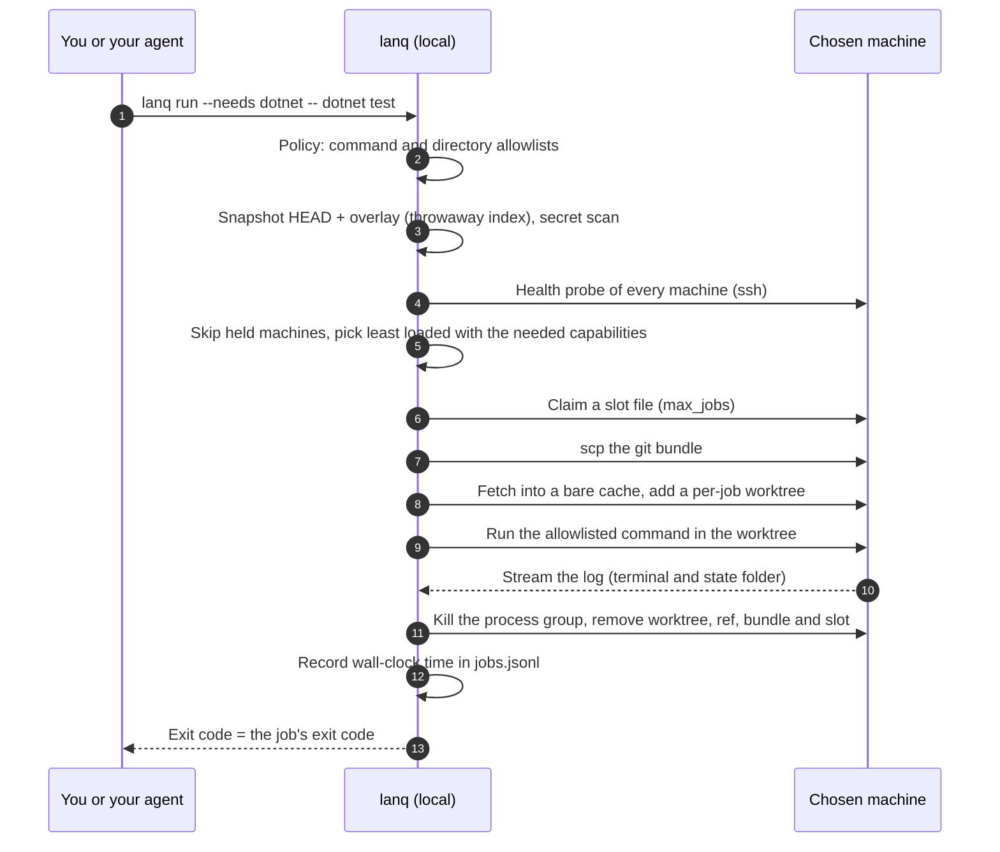

<p align="center"></p>

# LanQueue

**RAM and new hardware are expensive. Your old PCs are not. Plug them back in and give them work.**

`lanq` is a small .NET global tool that sends builds, tests, log analysis and headless coding-agent jobs to the other
computers you already own: the old desktop in the closet, the spare laptop, the small-form-factor box. Your old
machines can still help you get development done. All a worker needs is a LAN connection, SSH, git (or just `tar`, see
[Transfer modes](#transfer-modes-git-default-recommended-or-archive)) and the toolchain for your jobs, and it joins
your queue. Your dev PC stays free for writing code. Even a PC too old or locked down to install git can help: SSH,
tar and your toolchain are enough.

```bash
dotnet tool install --global LanQueue      # update later: dotnet tool update --global LanQueue
```

A 3-command taste (after you list your machines once in `machines.yml`, see [Quick start](#quick-start)):

```bash
lanq health                                                        # which machines are awake and free?
lanq run --needs dotnet,linux -- dotnet test -c Release            # run on the least loaded match
lanq stats                                                         # how long did jobs take?
```

For each job it checks which machines are awake and not busy, picks the least loaded one that has what the job
needs, ships your current git state (HEAD plus uncommitted changes) to a throw-away worktree over key-only SSH, runs
one allowlisted command, streams the log back, cleans up, and records how long it took. It is headless and
scriptable, it has no daemon and no server to install on the remote machines (just `ssh`, `git` or `tar`, and a shell), and it
sends nothing anywhere except to the hosts you list. There is no telemetry.

## Why this exists

This is the author's first-hand account, not a benchmark. The author works on two projects (a .NET API and a web
front end) from one dev PC. One overnight run put two heavy agent-driven build/test jobs, the local dev stack and a
scheduled task on that single machine at the same time. The local API crashed, the front-end dev server broke, a
task expected to take an hour or two took most of an afternoon, and the failures that night were machine load, not
code defects.

The fix was organisational before it was technical: allow one heavy job at a time on the dev PC, and send builds
and tests to two spare machines on the LAN (a build box and a small-form-factor PC) over key-only SSH, so the dev PC
stays free for writing code and orchestrating. Along the way the author hit the usual remote-Windows traps (stale
incremental builds after file overlays, "Filename too long" in deep worktrees, quirks of running tests over SSH).
`lanq` is that routine turned into a tool.

`lanq stats` records wall-clock time per job in a local log. There are no published measurements yet, and this README
makes no speed-up claim.

## Install

Requires the .NET 10 SDK or runtime on the machine you run `lanq` from, and `git` and `ssh`/`scp` on the PATH.
Remote machines need an SSH server (Linux: `sh`; Windows: OpenSSH Server with PowerShell 5.1+) and either `git`
(the default) or `tar` (with `transfer: archive`).

```bash
dotnet tool install --global LanQueue
dotnet tool update --global LanQueue       # later, to upgrade
```

Package: [nuget.org/packages/LanQueue](https://www.nuget.org/packages/LanQueue). Prefer to build it yourself? From a
clone:

```bash
dotnet pack src/LanQueue -c Release -o ./nupkg
dotnet tool install --global --add-source ./nupkg LanQueue
```

## Quick start

Before your first job, each worker needs an SSH server, git (or only `tar` in archive mode) and the toolchain your jobs use; it does **not** need
GitHub access, Docker (unless your jobs use it) or lanqueue itself. Checklist and setup steps:
[docs/WORKERS.md](docs/WORKERS.md).

1. Copy `machines.example.yml` to a private location (for example `~/.config/lanq/machines.yml`, or
   `%APPDATA%\lanq\machines.yml` on Windows) and edit it. A config in the current directory is never picked up
   implicitly; pass `--config FILE` or set `LANQ_CONFIG`.
2. Make sure key-based login works and the host key is already in `known_hosts`. With a key loaded in ssh-agent
   (recommended, see [Keeping your keys safe](#keeping-your-keys-safe)): `ssh user@build-01.lan true`.
3. Check the fleet:

   ```
   $ lanq health
   build-01       OK    load 0.12  disk free 180.4 GB  slots 0/2
   build-02       HOLD  load 0.05  disk free 90.1 GB  slots 0/1 (outside allowed hours)
   ```

4. Run something from inside a git repository:

   ```bash
   lanq run --needs dotnet,linux --dir tests -- dotnet test -c Release
   ```

   The job's exit code becomes `lanq`'s exit code. `--wait 120` keeps retrying for up to 120 seconds when every
   machine is busy or on hold. `--timeout 60` stops the job after 60 minutes (default 240). `lanq stats` sums
   wall-clock time from your local log.

Exit codes: the job's own code; `2` rejected by policy or bad arguments; `70` infrastructure error (SSH, git);
`75` no eligible machine; `124` the job ran past `--timeout` and was stopped.

## How it works



Where each safety check sits (numbers are the diagram steps):

| Step | Check |
| --- | --- |
| 2 | Command and directory must match your allowlists; permission-skipping flags are refused. Nothing has touched the network yet. |
| 3 | The command line and the uncommitted overlay are secret-scanned; a hit refuses the job before anything is sent. |
| 4-5 | Machines that are unreachable, loaded, outside their hours, low on disk or missing a capability are skipped. |
| 6 | `max_jobs` is enforced with an atomic slot file per machine. |
| 4-10 | Every ssh/scp call is key-only, non-interactive and uses `StrictHostKeyChecking=yes`. |
| 11 | Cleanup runs even when the job fails, is cancelled or times out (best effort if the network is down). |

### The steps in words

1. The command and directory are checked against your policy. Rejected jobs never touch the network.
2. HEAD plus uncommitted and untracked, non-ignored files are snapshotted into a commit using a temporary index
   (your index, branches and working tree are untouched) and bundled. The overlay is scanned for secrets.
3. Every machine is probed; those that are unreachable, over the load threshold, outside their hours, full or
   missing a required capability are skipped. The rest are ranked by load.
4. A slot file is claimed atomically on the chosen machine (`max_jobs` per machine), the bundle is uploaded with
   `scp`, fetched into a bare cache repo, and a detached `git worktree` is created for the job.
5. The command runs in the worktree; output streams to your terminal and to `<state>/logs/<job>.log`, where
   `<state>` is `$LANQ_HOME` or a per-user folder (`%LOCALAPPDATA%\lanq`, or `~/.local/state/lanq`), never your repo.
6. The worktree, ref, bundle and slot are removed, even if the job failed. Wall-clock time is appended to
   `<state>/jobs.jsonl`. Any `.lanq/` folder in the repository is excluded from the snapshot.

## Transfer modes: git (default, recommended) or archive

Each machine in `machines.yml` has an optional `transfer` setting:

- **`git`** (the default, recommended): `lanq` sends a git bundle and the worker keeps a bare cache repo with a
  detached worktree per job. Later jobs on the same worker are cheaper to prepare. The worker needs `git`.
- **`archive`**: `lanq` builds the same snapshot (HEAD plus uncommitted and untracked files, honouring `.gitignore`,
  never `.lanq/`) on your PC and sends it as a `tar.gz`; the worker extracts it into a fresh per-job folder with its
  own `tar`: GNU tar (with gzip) on Linux, or the bsdtar built into Windows 10 1803+ / Server 2019+. **The worker does
  not need git at all**, so the old PC that cannot or should not have git installed still joins the queue: SSH + tar +
  your toolchain. A worker whose `tar` is busybox tar (Alpine and many minimal images) is refused, because its
  listing cannot be trusted; install GNU tar there or use `transfer: git`.

Everything else is identical in both modes: the allowlists, forbidden flags and secret scan run on your PC before
anything is sent, the directory checks and process-group kill apply to the job folder, and cleanup removes the job
folder, the upload and the slot. Archive mode copies the files, not history, so a job that needs git metadata (for
example one that runs `git log` or `git describe`) should run on a `git` machine. Symlinks and submodules are
skipped, not archived (only regular files and directories are), and the job output reports how many were skipped.
Paths that Windows cannot store (names ending in a dot or space, the characters `<>:"|?*`, or device names such as
`CON`, `NUL` or `COM1`) make the archive build fail with the offending path and rule, because any worker could be a
Windows one.

`lanq health` checks `git --version` on `git` machines, and on `archive` machines that `tar` is GNU tar or bsdtar
(plus `gzip` on Linux), and holds a machine that lacks the tool, with the reason.

## Keeping your keys safe

`lanq` never stores or sends your key; it only calls `ssh` and `scp`. The aim is that a synced folder, a stolen
laptop or a leaked log cannot hand someone a way into your build machines.

- **Prefer a passphrase-protected key held by ssh-agent.** Omit `key_env` in `machines.yml` and `lanq` passes no
  `-i`; ssh uses whatever your agent holds (still `BatchMode=yes`, so a missing identity fails fast instead of
  prompting). Create a key with `ssh-keygen -t ed25519` and choose a passphrase.
- **Windows.** The OpenSSH Authentication Agent service is disabled by default. From an elevated PowerShell:
  `Get-Service ssh-agent | Set-Service -StartupType Automatic`, then `Start-Service ssh-agent`, then
  `ssh-add $env:USERPROFILE\.ssh\id_ed25519`. Microsoft's guide suggests backing the key up somewhere safe and then
  deleting the plain file from the machine once it is in the agent.
- **Linux / macOS.** Run an agent and `ssh-add ~/.ssh/id_ed25519`; `ssh-add -l` lists what is loaded and
  `ssh-add -t <seconds>` limits how long a key stays loaded. To share one agent across logins on Linux,
  [keychain](https://www.funtoo.org/Keychain) works: put ``eval `keychain --eval id_ed25519` `` in your shell profile.
- **Hardware-backed keys.** `ssh-keygen -t ed25519-sk` creates a key whose secret lives on a FIDO2 token (touch is
  required by default). It needs a token and FIDO-capable OpenSSH on both ends, and a person to touch it, which
  suits interactive use better than unattended overnight runs.
- **If you must use a key file** (`key_env`): keep it out of every repository and out of synced folders (OneDrive,
  Dropbox, iCloud); restrict it (`chmod 600 ~/.ssh/id_ed25519`; on Windows, in PowerShell `icacls <file> /inheritance:r /grant:r "${env:USERNAME}:F"`, in cmd
  `icacls <file> /inheritance:r /grant:r "%USERNAME%:F"`); and give it a passphrase. `lanq health` warns when a configured OpenSSH-format
  key file opens with an empty passphrase (checked with `ssh-keygen -y -P ""`). Other key formats and `-sk` keys
  are not checked, so no warning is not a guarantee.
- **Use a dedicated low-privilege build user on each worker.** Build tools run project code with that user's
  rights, so give it nothing but its `work_root`. On Windows, a standard (non-admin) user's keys go in
  `~\.ssh\authorized_keys`; administrator accounts use `C:\ProgramData\ssh\administrators_authorized_keys`.
- **Restrict the key on the worker** in that user's `authorized_keys`, for example
  `restrict,from="<your-lan-subnet>" ssh-ed25519 AAAA... lanq-build`. `restrict` turns off port, agent and X11
  forwarding and PTY allocation, none of which `lanq` needs; `from=` accepts CIDR notation, so a stolen key is
  useless off your LAN. Replace the placeholder with your LAN subnet in CIDR form.
- **Secrets that are not the SSH key: PowerShell SecretManagement + SecretStore.** Use them for the key
  *passphrase* and any job tokens: `Install-PSResource Microsoft.PowerShell.SecretManagement` and
  `Install-PSResource Microsoft.PowerShell.SecretStore` (or `Install-Module`), then
  `Register-SecretVault -Name SecretStore -ModuleName Microsoft.PowerShell.SecretStore -DefaultVault`,
  `Set-Secret -Name BuildToken -Secret "..."` and `Get-Secret -Name BuildToken` (add `-AsPlainText` only where you
  must). It is not a home for the SSH key *file*: ssh wants a key file or an agent, while the vault stores
  strings, `SecureString`, `PSCredential`, byte arrays and hashtables for PowerShell to read back. Microsoft
  states these modules are feature-complete and receive security and critical fixes only.

Sources: [Microsoft, key-based authentication in OpenSSH for Windows](https://learn.microsoft.com/en-us/windows-server/administration/openssh/openssh_keymanagement),
[Microsoft, SecretStore getting started](https://learn.microsoft.com/en-us/powershell/utility-modules/secretmanagement/get-started/using-secretstore?view=ps-modules),
[ssh-keygen(1)](https://man.openbsd.org/ssh-keygen.1), [ssh-add(1)](https://man.openbsd.org/ssh-add.1),
[sshd(8)](https://man.openbsd.org/sshd.8).

## Two ways to use it

### As a developer, directly

```bash
lanq health                                                    # who is awake and idle?
lanq run --needs dotnet,linux -- dotnet test -c Release        # exit code is the job's exit code
lanq run --needs dotnet --dir tests --wait 120 -- dotnet test  # wait up to 2 minutes for a free machine
lanq run --needs dotnet --timeout 30 -- dotnet test            # stop the job after 30 minutes (exit 124)
lanq stats                                                     # wall-clock time per machine
```

You own `machines.yml` and the allowlists. Edit them yourself; nothing else should.

### With a coding agent such as Claude Code (scripts-first)

Coding agents are good at deciding *what* to build and test. They are wasteful at working out *how* to reach a
remote box on every turn: composing ssh commands, retrying, and pasting long logs back into the conversation, all
of which spends context. With `lanq` the agent runs one deterministic command and reads one exit code plus the
last lines of output. The remote mechanics, the allowlist and the cleanup live in code instead of being re-derived
in prose each time. (This is a qualitative argument; this repository does not publish a token measurement.)

```bash
lanq run --needs dotnet -- dotnet test -c Release > "${TMPDIR:-/tmp}/lanq-last.log" 2>&1; echo "exit=$?"; tail -n 40 "${TMPDIR:-/tmp}/lanq-last.log"
```

On Windows PowerShell:

```powershell
$log = Join-Path $env:TEMP 'lanq-last.log'; lanq run --needs dotnet -- dotnet test -c Release *> $log; "exit=$LASTEXITCODE"; Get-Content $log -Tail 40
```

The agent keeps the exit code and a short tail, and opens more of the log file only when the tail is not
enough. The log lives in the temp folder, not in your repository; lanq also keeps full per-job logs in its own state
folder (`$LANQ_HOME`, else a per-user folder). (A `.lanq/` folder in the repository is excluded from the snapshot.)

Ready-to-copy assets live in [docs/agents/](docs/agents/):

- [`CLAUDE.md-snippet.md`](docs/agents/CLAUDE.md-snippet.md): rules to paste into your project's `CLAUDE.md`.
- [`skills/lanq/SKILL.md`](docs/agents/skills/lanq/SKILL.md): a minimal Claude Code skill. Copy the `lanq` folder to
  `.claude/skills/` in your project (or `~/.claude/skills/` for all projects).

The split is deliberate: the developer owns the config and allowlists; the agent only calls `lanq run`. Text in
`CLAUDE.md` or a skill is guidance the model follows, not enforcement (Claude Code's docs say to use a hook for
that). The hard stops are in `lanq`: it refuses commands outside your allowlist and permission-skipping flags. To
also keep the agent away from the config file, use Claude Code permission rules or a hook.

## Configuration reference

```yaml
policy:
  load_threshold: 0.80        # (0,1]; load average per core (Linux) or CPU% (Windows) above this = hold short
  min_free_disk_gb: 5         # a machine with less free space on its work_root drive is held (default 5)
  allowed_commands: [...]     # argv must START with one of these token sequences, e.g. "dotnet test"
  allowed_directories: [...]  # relative to the repo root; "src" also allows "src/App"; "." allows only the root
machines:
  - name: build-01            # letters, digits, - _
    os: linux                 # linux | windows
    ssh: user@host            # no leading "-"
    key_env: ENV_VAR_NAME     # optional. Omit to use ssh-agent (no -i is passed). Else the NAME of an env var holding a key file path
    work_root: /srv/lanq      # Linux: absolute path. Windows: a drive path such as D:/lanq. Forward slashes, no spaces, no ".."
    capabilities: [dotnet]    # tags matched by --needs (all must be present)
    max_jobs: 2               # concurrent jobs via slot files
    transfer: git             # optional: git (default, recommended; worker needs git) | archive (worker needs only tar)
    allowed_hours: "22:00-07:00"   # optional; local time of the machine running lanq; may wrap midnight
```

Unknown keys are an error (so a `password:` field is refused rather than ignored). Config lookup: `--config`,
then `$LANQ_CONFIG`, then the per-user config folder (`~/.config/lanq/machines.yml` or `%APPDATA%\lanq\machines.yml`).
`LANQ_HOME` moves the state folder (job log, logs, scratch); it defaults to a per-user folder outside any repository.

## Security model

Each default below is enforced in code and covered by a unit test.

- **Key-only SSH.** Every ssh/scp call uses `BatchMode=yes`, `PasswordAuthentication=no`,
  `KbdInteractiveAuthentication=no`, `PreferredAuthentications=publickey` and `StrictHostKeyChecking=yes`. There is
  no password option anywhere in the config.
- **Command allowlist.** Only argv beginning with a configured token sequence runs. Each argument is individually
  quoted for the remote shell, so `dotnet test; rm -rf /` as one argument is neither allowed nor interpreted.
- **Directory allowlist.** Jobs run only in allowlisted, relative directories inside the job worktree; `..`,
  absolute and drive-letter paths are refused.
- **Best-effort secret scan.** The command line and the uncommitted overlay are scanned for private-key blocks,
  AWS/GitHub/Slack/`sk-` tokens, JWTs, bearer tokens, and password/secret/API-key style assignments (quoted, JSON,
  YAML, `.env` and `Password=...;` connection strings). Files named like `.env`, `*.pem`, `*.pfx`, `*.jks`,
  `id_rsa`, `*.tfvars`, `terraform.tfstate`, `.git-credentials`, `.aws/credentials` or `*.local.yml` are refused by
  name. A hit refuses the job before anything is sent, and the message never echoes the value. If a scan pattern
  times out the job is refused (fail closed). This is a safety net, not a guarantee: it does not scan committed
  history or binary files, and it cannot recognise every secret format.
- **No permission-skipping agent flags.** Any argument containing `dangerously`, `skip-permissions`,
  `bypassPermissions`, `--yolo`, `bypass-approvals`, `danger-full-access`, `approval_policy=never` or
  `--ask-for-approval never` is rejected, even for an allowlisted command.
- **Isolation.** One detached worktree (git mode) or one fresh extracted folder (archive mode) per job, removed
  afterwards. Gitignored files are never shipped.
- **Archive extraction is checked before it happens.** `lanq` refuses to create an archive with an absolute path, a
  `..` segment, a backslash or a name Windows cannot store; non-regular entries (symlinks, submodules) are skipped
  and reported, never archived. The worker uses only GNU tar or bsdtar (busybox tar is refused, because it hides hard
  links and rewrites paths in its listing), lists the archive first (`tar -tzf` and `tar -tvzf`) and refuses it,
  writing nothing, if any entry is absolute, contains `..` or a backslash, is anything but a file or directory, or is
  shown as a link (symlink or hard link). Windows workers call the built-in `System32\tar.exe` by full path; the health probe checks once that
  it accepts `--no-acls --no-xattrs --no-fflags --no-same-owner --no-same-permissions` (otherwise the machine is
  held), and Prepare then extracts exactly once with those flags, with no fallback or retry. Linux extraction runs
  with `--no-same-owner --no-same-permissions`. This is checked by tests that run the generated scripts against
  crafted hostile archives; it is a defence in depth for a trusted-network tool, not a sandbox.
- **No telemetry**, no network access except the SSH hosts you configure.

See [SECURITY.md](SECURITY.md) for what this does not protect against.

## Limitations

- The secret scan is pattern-based and best effort; it does not scan already-committed history or file contents
  of binary files. It is a safety net, not a guarantee.
- The allowlist limits what `lanq` will start, not what an allowlisted program does. Build and package tools such as
  `dotnet test`, `dotnet build`, `npm test` and `npm ci` execute project code (test code, MSBuild targets, npm
  lifecycle scripts) with the remote user's rights. Only run code you trust, and use a dedicated low-privilege
  account on the remote machines.
- Cancellation and timeouts: cleanup kills the job's process group (Linux) or PowerShell process tree (Windows)
  recorded in `locks/job-<id>.pid` before removing the worktree. This is best effort: it needs the machine to be
  reachable when cleanup runs (if the network is down, the job may keep running until it ends on its own), and a
  job that deliberately detaches into a new session or process group can escape it.
- Windows remote commands are passed as an encoded command line limited to roughly 8000 characters; very long
  argument lists are refused with a clear message.
- The full HEAD history is bundled on every run in git mode (no incremental transfer yet). Archive mode sends the
  whole working snapshot each time, with no history and no cache.
- A crashed orchestrator can leave a slot file behind; delete `locks/slot-N` (and any stale `locks/job-*.pid`) under
  the machine's `work_root`.
- No persistent queue: `--wait` polls every 15 seconds. Windows arguments containing embedded double quotes can
  be mangled by PowerShell 5.1 native-command argument passing.
- `allowed_hours` uses the clock of the machine running `lanq`. In tests the generated Linux scripts are
  checked with `sh -n` and the Windows scripts with the PowerShell parser, but only when those shells exist on the
  machine running the tests (otherwise those checks are skipped), and the scripts have so far been exercised only
  against fakes plus a local process-group test; report any real-host defects.

## Compared with interactive agent-fleet apps

Desktop apps such as [Orca](https://github.com/stablyai/orca) are interactive: you watch and steer many coding
agents, each in its own worktree, from a GUI, with diff review and PR integrations. LanQueue is a different shape:
a headless command that routes one job at a time to a machine by capability and load, with a policy file in front
of it. It does not run or supervise agents interactively, has no UI, and installs nothing on the remote machines.
They can complement each other; choose by whether you want a cockpit or a dispatcher. (Feature descriptions are
based on each project's public README at the time of writing; check the project for current details.)

## Contributing and licence

See [CONTRIBUTING.md](CONTRIBUTING.md) and the [CHANGELOG](CHANGELOG.md). MIT licensed, see [LICENSE](LICENSE).
